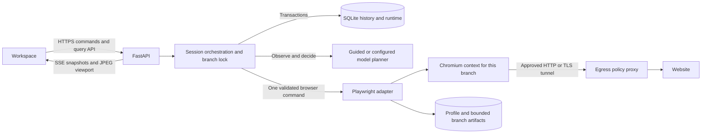
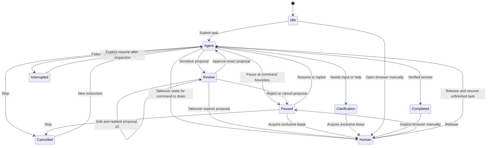
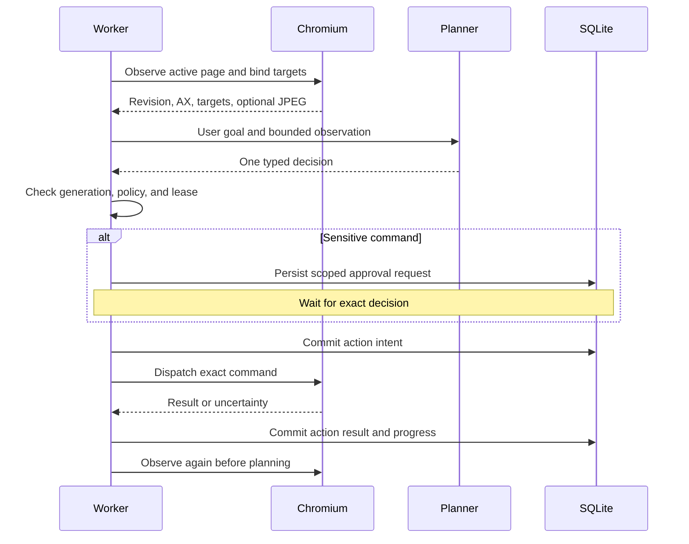
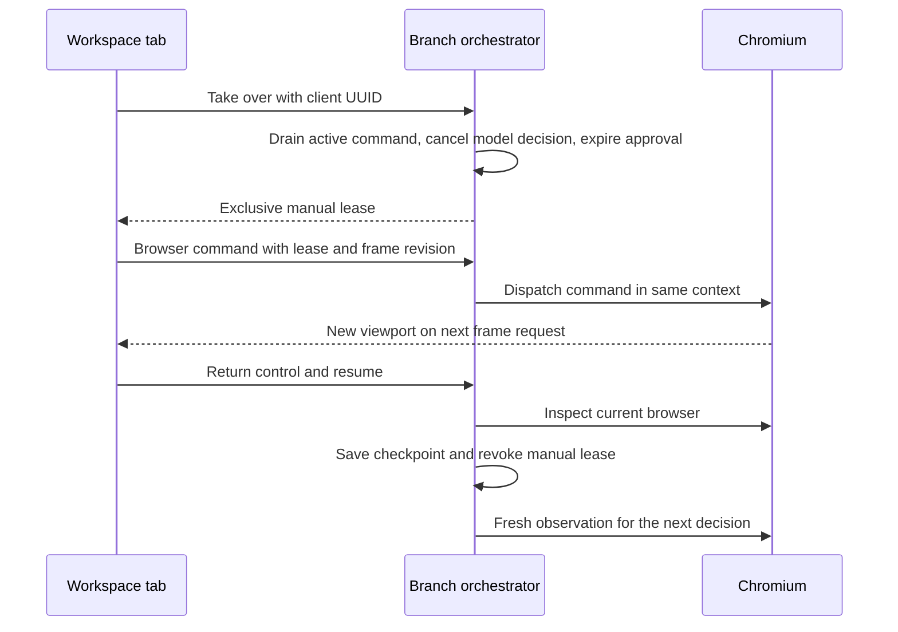
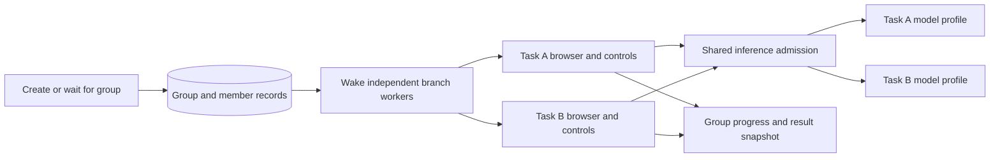

# Architecture

## Integration map

| Existing component | Change |
| --- | --- |
| FastAPI routes, SQLAlchemy repositories, SQLite, session/branch IDs | Retained. Added workspace and browser routes, bounded history queries and checkpoint scope validation. Existing databases use the same tables. |
| In-process execution manager and branch mutex | Retained. Live mode coalesces follow-up wakeups and uses the mutex for each browser command and control transition. |
| Planner, navigator, extractor and optional Ollama enrichment | Retained for the existing fake-adapter pipeline. Live tasks use a typed one-decision planner and grounded observation instead of the prototype's fixed comparison plan. |
| `BrowserUseAdapter` | Historical integration code. The live app uses Playwright because it can gate each concrete effect before dispatch. |
| Browser paths, checkpoints and replay | Retained. Real Chromium profiles and files are scoped to a branch. A fork copies logical history into a new branch and starts with an independent Chromium profile. |
| Polling HTML workspace | Replaced with a browser viewport, session and branch selector, conversation, activity, approvals, checkpoints and file controls. |

The viewport is the largest pane. Tabs and the URL sit above it, and the control bar stays alongside execution state. Conversation and activity share a secondary pane so reading long logs leaves the viewport usable. A chat-first layout makes review easier but puts the browser farther away during a handoff. A permanent third pane shrinks the viewport on laptops. The interface collapses into stacked panels on narrow screens.

## Ownership and run state

The branch mutex is the single admission point for browser input. Agent inference is cancellable outside the mutex. An admitted browser operation retains the mutex through completion or its deadline, even if the manual HTTP client disconnects. An operation that has begun can have side effects. Every manual browser command carries a lease, a client UUID, a browser revision, and a command UUID. The lease grants one workspace tab control for one branch, contingent on committed manual ownership. Its recent 128 command IDs deduplicate retries for the lifetime of that lease. Reloading the same workspace tab can recover the lease, while inactivity or process restart expires it. The user must acquire a new lease before sending input after expiration. Agent output carries a generation and is discarded after control or task changes. Document navigation, tab changes and browser restarts invalidate viewport revisions. The workspace attaches an opaque frame proof to coordinate clicks. Chromium rechecks the surrounding pixels before dispatch. The proof has a capture-to-input interval and cannot detect pixel-identical behavior changes. Direct API callers can supply coordinates without proof and are responsible for their freshness. Agent targets are separately bound to observed element handles and checked again at dispatch.

## Wire protocol

The HTTP routes are listed in `/docs`. Sessions scope all subresources, including branch IDs, checkpoints and artifacts. State-changing endpoints accept JSON, except staged uploads which accept raw file bytes and an `X-Artifact-Name` header.

| Path under `/sessions/{id}` | Contract |
| --- | --- |
| `/stream` | SSE `workspace` events containing `{session, messages, events}` with a 120-message and 180-event window. The server emits a snapshot when its content changes. An opaque hash in `id` suppresses retransmission of an identical snapshot on reconnect. The browser requests a new snapshot when it opens a new stream. |
| `/workspace` | HTTP snapshot fallback. The same SQLite read transaction routine serves both snapshot transports. |
| `/events`, `/messages`, `/replay` | Durable history. `after_event_id` pages forward and message `before` pages backward in SQLite append order. Replay reconstructs a timeline from the saved timestamps, step indexes and record IDs. |
| `/browser`, `/browser/frame` | Live tab metadata and binary JPEG with `X-Browser-Revision`, `X-Browser-Frame-Id`, `X-Browser-Tab-Id`, `X-Browser-Width`, and `X-Browser-Height`. Frame capture is demand-driven and briefly shared among viewers. Browser data is separate from replay. |
| `/takeover`, `/browser/command`, `/release` | `X-Workspace-Client` identifies the tab. Mutations use an exclusive `lease_id`, `expected_revision`, and `command_id`. Stale control or state returns HTTP 409. |
| `/browser/close` | Releases the Chromium process and keeps history, profile, and artifacts. A current manual holder must present the lease. |
| `/pause`, `/resume`, `/stop`, `/replan` | Independent execution operations. Stop clears pending work. Replan clears pending proposals and resets the bounded action budget. |
| `/approve`, `/reject`, `/cancel-action`, `/edit-action` | Decisions refer to one `correlation_id`. An edit retains the kind and target, replaces the proposal ID and requires approval again. An explicit Pause survives approval until Resume. |
| `/browser/upload`, `/browser/artifacts/{id}` | Scoped file staging and download. No arbitrary client-supplied host paths. |

Events record the actor, action, step, correlation, status and result summary when available. A step index is task progress, so control events can share it. The SSE snapshot can recover the current view after a gap. Recovering older data uses the paged REST history. JPEG payloads and detailed model inputs stay outside the event store.

## Persistence and failure behavior

The runtime row holds logical task state, a bounded history of recent outcomes and the last safe URL and tab summary. A durable action-intent marker precedes dispatch. The app records uncertainty when a command may have taken effect and the outcome cannot be confirmed. After review and Resume, the first new agent command requires approval. Unused approvals expire across restart because element handles and revisions are process-specific. Resume reconnects the Chromium profile and normally opens the saved URL. A branch with an uncertain effect starts on a blank page if its browser is gone. Persisted cookies depend on Chromium's profile and site settings. Runtime DOM, back/forward state, exact tab contents, and unsaved form data can be lost. Branch creation copies the exact history prefix and uses a new empty profile.

A single process owns leases, browser workers and profiles. Deployment uses one worker. SQLite write transactions stay short and browser or provider calls run outside write transactions. The app uses bounded action counts, timeouts, JPEG capture and artifact quotas. Each persistent context starts a Chromium process, making per-branch memory the main scale constraint.

## Coordinated task groups

Group creation writes the group, member sessions and branch instructions in one SQLite transaction. Only committed branches can be scheduled. The client can retry a submission with the same UUID and payload. A retry that reuses the UUID for a different payload is a conflict. Each branch retains its own lock, browser, checkpoint history and approvals. A paused or blocked task therefore leaves peers free to run. A group snapshot derives status and results from the linked branches, including later task redirections. It does not copy browser observations or answers between models.

The group stream uses the same snapshot transport as the session view. API clients can wait until all tasks are terminal or until any task needs attention. Waiting consumes no model or browser slot. A wait deadline leaves the group running. Active tasks become interrupted after a process restart. Durable tasks that were still queued are scheduled again. When the browser pool is full, a task can wait for capacity with no branch lock held. Closing an unused browser releases capacity while keeping its profile and history.

Inference has a separate shared concurrency limit. Requests waiting on it do not consume the per-request inference timeout and can be cancelled by branch controls. The UI distinguishes waiting for model capacity from inference in progress. The activity log includes model selection, time waiting for a slot, inference duration, and token counts when the provider reports usage. Selected profiles are keyed by operator-defined aliases and checked against the saved model, endpoint and vision configuration. Profiles send requests to loopback runtimes. The runtime controls model residency and may continue server-side work briefly after client cancellation.

## Threat model

| Threat | Implemented boundary and remaining exposure |
| --- | --- |
| A page directs the agent to submit data or take over | Page text and screenshots are untrusted model inputs. The model can return one schema-validated command. Clicks, typing, key presses, uploads, sensitive domains and model-selected destinations require review. Conventional GET navigation and page-driven scripts can still have side effects. |
| SSRF, redirect to loopback, DNS rebinding | HTTP(S) and destination policy are checked by the adapter and an authenticated loopback forward proxy that connects to the checked IP. Explicit private grants can be narrowed to a port. The redirect denial is tested. Deploy an OS or container egress policy for remote use, including Chromium features outside proxied HTTP. |
| Competing inputs or stale approvals | The branch mutex, revision checks, target binding, scoped approvals and exclusive manual lease prevent concurrent admission. Timeouts and crashes can leave an already dispatched effect uncertain. |
| Unauthorized access | Loopback bind by default, host validation, cross-site request rejection, and optional HTTP Basic or Bearer authentication. One token covers the workspace. TLS, per-tenant authentication and separate instances are deployment concerns. |
| Credential exposure | No personal profile is attached. Password fields are masked in JPEGs, common secret URL parameters are redacted, and raw manual typing and raw approval payloads are excluded from audit events. Browser profiles and ordinary page content can still contain secrets. Protect data at rest and only enable hosted inference for permitted data. |
| Unsafe files and resource exhaustion | Downloads use attachment responses and per-file and file-count limits. Uploads use explicit scoped artifact IDs. Use disk quotas, egress limits, workload isolation and malware controls on a shared host. |

Research on page-aligned prompt injection motivated the separate command gate. [Mind the Web](https://arxiv.org/abs/2506.07153)
