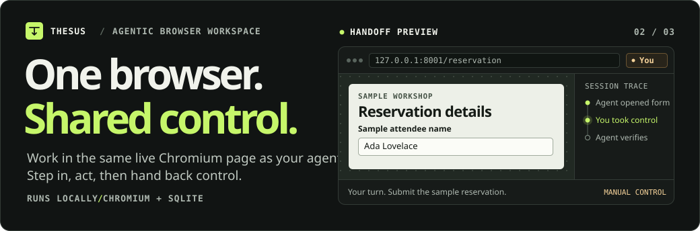
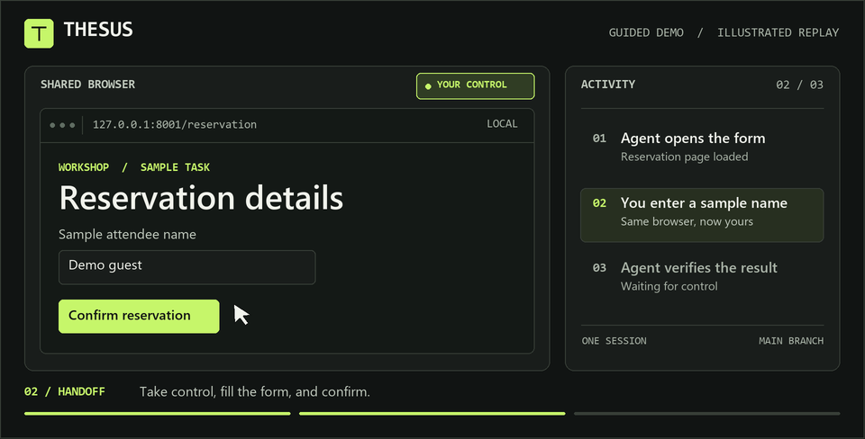

# THESUS

<picture>
  <source media="(max-width: 620px)" srcset="docs/pages/assets/repository-hero-mobile.svg">
  
</picture>

THESUS lets you and an agent share a live Chromium browser. You can review proposed actions, take control of the page, and hand it back so the agent can continue. THESUS keeps a local history of decisions and checkpoints in SQLite.

**[Quick start](#quick-start)** · [Guided demo](#demonstrate-without-model-credentials) · [Use a model](#run-a-natural-language-task) · [Troubleshooting](#troubleshooting) · [Project tree](#project-tree)

| 01 / Control | 02 / Review | 03 / History |
| --- | --- | --- |
| **Take the wheel.**<br>Click, type, and scroll in the live browser yourself. Return control in the same session. | **Approve actions.**<br>Inspect proposed clicks, text entry, and form submissions before the agent acts. | **Keep the trail.**<br>Replay recorded activity or create a branch from a checkpoint. |

## Quick start

Install Python 3.12 or newer. Python 3.12 is the version used in the [project validation](docs/validation.md). If you need a local copy and have Git installed, clone the repository. Run the rest of the commands from the folder that contains `main.py`.

```sh
git clone https://github.com/VonSchugel/thesus.git
cd thesus
```

### Start on Windows

In PowerShell, check that `py -3.12 --version` reports Python 3.12. If you installed a newer version, use its version number in place of `-3.12`. Create a fresh environment and install Chromium into it.

```powershell
py -3.12 -m venv .workspace-venv
$workspacePython = '.\.workspace-venv\Scripts\python.exe'
& $workspacePython -m pip install -r requirements.txt
& $workspacePython -m playwright install chromium
```

### Start on macOS or Linux

Check that `python3 --version` reports Python 3.12 or newer. Create a fresh environment and install Chromium into it.

```sh
python3 -m venv .workspace-venv
./.workspace-venv/bin/python -m pip install -r requirements.txt
./.workspace-venv/bin/python -m playwright install chromium
```

Continue to the [guided demo](#demonstrate-without-model-credentials) for a first run, or [configure a model](#run-a-natural-language-task) to give the agent your own tasks.

## Demonstrate without model credentials

The guided demo uses a sample reservation site on port `8001` and the THESUS workspace on port `8000`. Open two terminals in the project folder and keep both running.

### Windows PowerShell

**Terminal 1 — Start the reservation site.**

```powershell
& '.\.workspace-venv\Scripts\python.exe' scripts/demo_site.py
```

**Terminal 2 — Start THESUS in demo mode.**

```powershell
$env:BROWSER_BACKEND = 'playwright'
$env:BROWSER_AGENT_PROVIDER = 'disabled'
$env:BROWSER_ALLOWED_DOMAINS = '127.0.0.1'
$env:BROWSER_PRIVATE_HOSTS = '127.0.0.1:8001'
$env:BROWSER_DEMO_URL = 'http://127.0.0.1:8001/'
& '.\.workspace-venv\Scripts\python.exe' main.py
```

<details>
<summary>macOS and Linux commands</summary>

**Terminal 1 — Start the reservation site.**

```sh
./.workspace-venv/bin/python scripts/demo_site.py
```

**Terminal 2 — Start THESUS in demo mode.**

```sh
BROWSER_BACKEND=playwright \
BROWSER_AGENT_PROVIDER=disabled \
BROWSER_ALLOWED_DOMAINS=127.0.0.1 \
BROWSER_PRIVATE_HOSTS=127.0.0.1:8001 \
BROWSER_DEMO_URL=http://127.0.0.1:8001/ \
./.workspace-venv/bin/python main.py
```

</details>

### The handoff

1. Open [the THESUS workspace](http://127.0.0.1:8000). Choose **New session**, then **Run guided demo**. You can also send `Demo: http://127.0.0.1:8001/` in the conversation.
2. When the reservation form appears in the workspace viewport, choose **Take control**. Enter a sample name and click **Confirm reservation** inside the viewport.
3. When the viewport shows **Reservation received**, choose **Return control**. The agent verifies the confirmation and the task shows **Completed**.

To try a download, take control again, choose **Download sample receipt** in the viewport, and open **Files** in the workspace. To shut down the demo, press `Ctrl+C` in each terminal.

<details>
<summary>Preview the handoff</summary>

[](docs/pages/assets/handoff.gif?raw=true)

[Play the 9-second GIF](docs/pages/assets/handoff.gif?raw=true)

</details>

## Run a natural-language task

Choose a provider below and add its settings to `.env` next to `main.py`. Update any existing values for those keys. THESUS reads `.env` at startup, and values already set in the terminal take precedence. If you ran the guided demo, stop it and launch from a fresh terminal so its demo settings are cleared.

### Use a local Ollama model

Start Ollama and pull a model that supports structured output. For example, run `ollama pull qwen3:0.6b`. Use the installed model's exact tag in `.env`.

```dotenv
BROWSER_BACKEND=playwright
BROWSER_AGENT_PROVIDER=ollama
BROWSER_AGENT_MODEL=qwen3:0.6b
```

`OLLAMA_HOST` defaults to `http://localhost:11434`. If you leave `BROWSER_AGENT_MODEL` unset, THESUS uses `OLLAMA_MODEL_NAVIGATOR`. [Ollama CLI](https://docs.ollama.com/cli)

### Use an OpenAI-compatible provider

Replace the example model ID and key with the values from your provider. Keep `.env` private.

```dotenv
BROWSER_BACKEND=playwright
BROWSER_AGENT_PROVIDER=openai
BROWSER_AGENT_MODEL=your-model-id
OPENAI_API_KEY=your-api-key
```

- For a different hosted endpoint, add `OPENAI_BASE_URL` with your provider's HTTPS API URL.
- For a local OpenAI-compatible server such as `llama-server`, set `OPENAI_BASE_URL=http://127.0.0.1:18177/v1` and use the model ID your server exposes. THESUS omits the hosted key from loopback HTTP requests.
- Hosted planning sends the task and bounded page observations to the configured provider. Set `BROWSER_AGENT_VISUAL=true` to allow a screenshot when the model requests one.

### Launch the workspace and send a task

- **Windows PowerShell** — `& '.\.workspace-venv\Scripts\python.exe' main.py`
- **macOS or Linux** — `./.workspace-venv/bin/python main.py`

Open [the workspace](http://127.0.0.1:8000), choose **New session**, and give the agent a goal with a starting URL. For example, send `Open https://example.com/ and report the page heading.`

When the agent asks for approval, review the action and its target. You can approve, edit supported parameters, reject or cancel the proposal, or take control. Choose **Return control** to resume from the current page. Use **Stop** to end the run or **Replan** to ask for a fresh decision.

## Run tasks together

1. Open **Task groups** and add at least two goals. Choose the default model or a configured profile for each task.
2. Select **Start group** to queue the tasks together. Each task gets its own browser profile.
3. Open a task from the dashboard to use its browser, review an approval, pause it, or redirect it. Other tasks can keep running while one waits for input.

To try grouping without inference credentials, start the [guided demo](#demonstrate-without-model-credentials) and enter the same `Demo: http://127.0.0.1:8001/` goal twice with different titles. Each task opens its own reservation form and needs its own handoff.

<details>
<summary>Configure named models and use the task-group API</summary>

To add named model choices, set `BROWSER_LOCAL_MODEL_PROFILES` before starting the workspace. This PowerShell example uses two Ollama tags. Check which tags are installed with `ollama list` and replace the example values as needed.

```powershell
$env:BROWSER_LOCAL_MODEL_PROFILES = @'
{
  "quick": {"label": "Quick text", "provider": "ollama", "model": "qwen3:0.6b"},
  "navigation": {"label": "Navigation", "provider": "ollama", "model": "qwen3:1.7b-q4_K_M"}
}
'@
$env:BROWSER_MODEL_PARALLELISM = '1'
```

For a local llama.cpp server, use `"provider":"llama_cpp"`, set `"model"` to the server's alias, and add `"base_url":"http://127.0.0.1:18177/v1"` to the profile. Ollama profiles default to `OLLAMA_HOST`. An Ollama profile can set `base_url` to another loopback Ollama server. Add `"visual":true` only when the selected model accepts images. The default workspace model is also selectable. A named profile is pinned to the task when created. If its model, endpoint, or vision setting changes, restore the original configuration or start a new task with the revised profile.

One model request at a time is the default for memory-constrained hosts. Browser work can overlap while requests wait for a model slot. Increase `BROWSER_MODEL_PARALLELISM` after configuring parallel slots or resident models in the inference server and measuring headroom. A full browser pool queues new tasks until a slot frees up. Close an unused browser to free a slot while keeping its profile, artifacts, and history. [Local model selection and measurements](docs/multitask-research.md)

API clients can start a group with `POST /task-groups` and then use `GET /task-groups/{id}/stream` for progress. Either `POST /task-groups` or `GET /task-groups/{id}` accepts `wait_seconds` up to 30 and `wait_for=settled` or `wait_for=attention`. A timed-out wait returns the current snapshot and leaves the tasks running. Include a UUID `request_id` on creation if you may retry the request.

</details>

## Investigate an authorized artifact

THESUS can inspect PE and ELF files, ZIP archives, JavaScript, and sanitized HTTP captures. Run `python -m pip install -r requirements-reverse-engineering.txt` with the Python executable from your workspace environment. Add `REVERSE_ENGINEERING_ENABLED=true` to `.env` and restart THESUS. The session-scoped API lets you review a plan, resume analysis, and inspect retained evidence. The optional read-only MCP bridge exposes saved evidence. [Setup and API](docs/reverse-engineering.md#run-an-investigation) · [Reproducible demonstrations](docs/reverse-engineering-validation.md)

## Troubleshooting

| Symptom | What to check |
| --- | --- |
| `py -3.12` cannot find Python | Install Python 3.12 or use the launcher selector for the newer version you installed. On macOS and Linux, check `python3 --version`. |
| A copied `.venv` is missing its Python executable | Create a fresh `.workspace-venv` using the [quick start](#quick-start). |
| Playwright cannot find Chromium | Run the Chromium install command again with the same environment you use to start THESUS. On Linux, missing system packages can be installed with `./.workspace-venv/bin/python -m playwright install --with-deps chromium`. |
| Port `8000` or `8001` is already in use | Stop the previous workspace or demo server before starting a second copy. If you change the demo port with `scripts/demo_site.py --port`, also change `BROWSER_PRIVATE_HOSTS` and `BROWSER_DEMO_URL`. |
| **Run guided demo** is missing or the form does not open | Open a new session and confirm both terminals are running. Check the demo URL and the exact `127.0.0.1:8001` entry in `BROWSER_PRIVATE_HOSTS`. |
| A model task still behaves like the demo | Restart THESUS from a fresh terminal and check the provider, model tag, and any domain rules in `.env`. Shell settings from the demo override `.env` in the demo terminal. |

## Project tree

```text
thesus/
├── main.py                  # Launch the local workspace
├── app/
│   ├── agents/              # Task planning and model providers
│   ├── api/                 # Session, control, and event routes
│   ├── core/                # Orchestration, browser handoff, and replay
│   ├── db/                  # SQLite models and persistence
│   ├── integrations/
│   │   └── browser/         # Chromium adapter and network policy
│   ├── models/              # Shared data contracts
│   ├── reverse_engineering/ # Artifact analysis and evidence
│   └── ui/                  # Browser viewport and workspace controls
├── scripts/                 # Guided demos and benchmarks
├── tests/                   # Browser, approval, and recovery tests
├── docs/                    # Research and validation reports
└── ARCHITECTURE.md          # System diagrams and API flows
```

[Architecture](ARCHITECTURE.md) · [Browser adapter](app/integrations/browser/playwright_adapter.py) · [Control lock](app/core/control_lock.py) · [Workspace UI](app/ui/) · [Validation](docs/validation.md)

## Configuration

| Setting | Default and purpose |
| --- | --- |
| `BROWSER_BACKEND` | `playwright` on a fresh configuration. Setting it explicitly overrides the legacy `USE_FAKE_BROWSER_ADAPTER` setting. Use `fake` for deterministic tests. |
| `APP_DB_URL` | `sqlite+aiosqlite:///./data/agentic_browser.db` |
| `DATA_DIR`, `PROFILE_DIR`, `SCREENSHOT_DIR` | Local data directories. Live profiles and artifacts are branch-scoped. The live viewport uses in-memory frames. |
| `BROWSER_ALLOWED_DOMAINS`, `BROWSER_PROHIBITED_DOMAINS` | Comma-separated browser hostname policy. An empty allowlist permits public sites, subject to the denylist. |
| `BROWSER_PRIVATE_HOSTS` | Explicit private destinations, preferably `host:port`. Empty by default. Keep the demo server and workspace on separate ports. |
| `SENSITIVE_DOMAINS` | Hosts and subdomains requiring review for agent actions. |
| `BROWSER_AGENT_PROVIDER`, `BROWSER_AGENT_MODEL` | `ollama`, `openai`, or `disabled`. The guided demo works with the provider disabled. |
| `BROWSER_AGENT_TIMEOUT_S`, `BROWSER_AGENT_MAX_STEPS`, `ACTION_RATE_LIMIT_MS`, `MAX_STEP_RETRIES` | Defaults `35`, `40`, `1200`, `2`. Replan to reset the action budget. |
| `BROWSER_LOCAL_MODEL_PROFILES` | JSON object of named Ollama or llama.cpp profiles. Empty by default. Profiles use loopback HTTP endpoints. |
| `BROWSER_MODEL_PARALLELISM`, `BROWSER_MAX_GROUP_TASKS` | Defaults `1` simultaneous model request and `6` tasks per group. |
| `BROWSER_TIMEOUT_MS`, `BROWSER_MAX_BRANCHES`, `BROWSER_MAX_TABS` | Defaults `5000`, `6`, `8`. Close unused browser tabs or use Close browser to reclaim a branch slot. |
| `BROWSER_SANDBOX`, `BROWSER_EXECUTABLE_PATH` | Sandbox enabled by default. Optional path to a compatible installed Chromium. The browser launches headless so all manual interaction passes through the workspace. |
| `BROWSER_ARTIFACT_LIMIT_BYTES` | `8388608` bytes per retained file. Downloads are attachments. Only explicit staged files can be uploaded. |
| `WORKSPACE_HOSTS`, `WORKSPACE_ACCESS_TOKEN` | Allowed Host headers, default `localhost,127.0.0.1`. Set an access token for remote use. The browser username is `workspace`, with the token as password. API clients can use Bearer authentication. |
| `WORKSPACE_LEASE_TIMEOUT_S` | `300` seconds without a heartbeat from the controlling workspace tab. Reacquire after expiration. |

## Operate and test

### Run the tests

Run the tests from the project folder after installing the application dependencies and Chromium. The browser tests use local fixtures and need no model credentials.

```powershell
& '.\.workspace-venv\Scripts\python.exe' -m pytest -q
```

On macOS or Linux, run `./.workspace-venv/bin/python -m pytest -q`. See the [validation guide](docs/validation.md) for individual tests and a manual walkthrough.

### Host the workspace remotely

Use one Uvicorn worker with persistent local volumes for SQLite and browser profiles. Use HTTPS, set a workspace access token and trusted host allowlist, and keep Chromium behind a network boundary that blocks access to local infrastructure. Disable proxy buffering for the event stream. Keep the service and browsers isolated from personal profiles and host credentials. A workspace token grants access to every session in its instance. Use separate instances and volumes for unrelated users.

See the [architecture](ARCHITECTURE.md), [research and selection notes](docs/research.md), [performance measurements](docs/optimization.md), and [adversarial audit](docs/adversarial-audit.md) for operating limits and test evidence.

## Project site

Preview the interactive handoff from the project directory.

```sh
python -m http.server 4173 --bind 127.0.0.1 --directory docs/pages
```

Open [the project site preview](http://127.0.0.1:4173/).

To publish, choose **GitHub Actions** as the source under **Settings → Pages**. Once the workflow is on the default branch, run **Publish project site** from the **Actions** tab. The workflow publishes only `docs/pages`.

