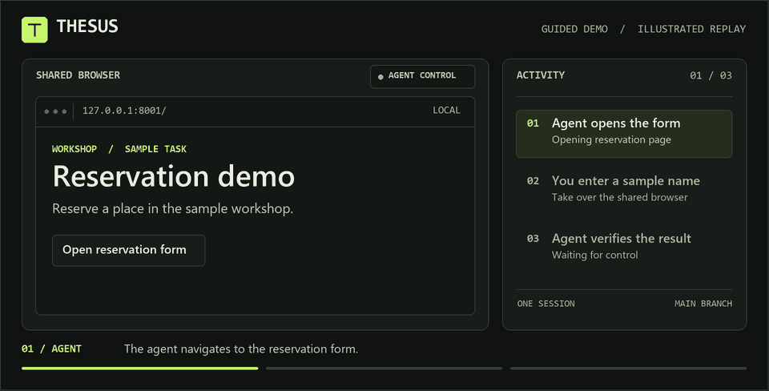

# THESUS

**Agentic Browser Workspace**

Share one live Chromium page with an agent. Give it a task, take over when you need to act, and hand control back so it can see what changed. The workspace runs locally on FastAPI and records conversations, decisions, and checkpoints in SQLite.

[Start on Windows](#start-on-windows) · [Run the guided demo](#demonstrate-without-model-credentials) · [Run tasks together](#run-tasks-together) · [Architecture](ARCHITECTURE.md) · [Preview the project site](#project-site)

<details>
<summary>Watch the browser handoff (animated GIF)</summary>



</details>

## Start on Windows

Install Python 3.12 or newer, then run these commands from this directory. If a copied `.venv` lacks `Scripts/python.exe`, create a fresh environment such as `.workspace-venv`.

```powershell
py -3.12 -m venv .workspace-venv
$workspacePython = '.\.workspace-venv\Scripts\python.exe'
& $workspacePython -m pip install -r requirements.txt
& $workspacePython -m playwright install chromium
$env:BROWSER_BACKEND = 'playwright'
& $workspacePython main.py
```

Open [the workspace](http://127.0.0.1:8000). `BROWSER_BACKEND=playwright` overrides `USE_FAKE_BROWSER_ADAPTER` in an older `.env`. The app reads `.env` automatically and gives shell settings precedence. On Linux or macOS use `python3.12 -m venv .workspace-venv` and `.workspace-venv/bin/python` in the equivalent commands. Linux hosts may need `python -m playwright install --with-deps chromium` and working Chromium sandbox support.

## Demonstrate without model credentials

In one terminal, run the isolated demo site.

```powershell
& '.\.workspace-venv\Scripts\python.exe' scripts/demo_site.py
```

In a second terminal, set the following and start the workspace.

```powershell
$env:BROWSER_BACKEND = 'playwright'
$env:BROWSER_AGENT_PROVIDER = 'disabled'
$env:BROWSER_ALLOWED_DOMAINS = '127.0.0.1'
$env:BROWSER_PRIVATE_HOSTS = '127.0.0.1:8001'
$env:BROWSER_DEMO_URL = 'http://127.0.0.1:8001/'
& '.\.workspace-venv\Scripts\python.exe' main.py
```

Choose **Run guided demo**, or send `Demo: http://127.0.0.1:8001/` in a new session. The guided planner opens the reservation form in Chromium and asks for help. Choose **Take control**, click the input in the viewport, enter a sample name, and select **Confirm reservation**. Choose **Return control** and check that the agent verifies the confirmation page. To try a download, take control again and select **Download sample receipt** on the confirmation page.

## Run a natural-language task

Start Ollama and install a model that supports structured output. Set `BROWSER_AGENT_PROVIDER=ollama` and `BROWSER_AGENT_MODEL` to the installed model. The existing `OLLAMA_HOST` defaults to `http://localhost:11434`, and `OLLAMA_MODEL_NAVIGATOR` supplies the model if `BROWSER_AGENT_MODEL` is unset. For a hosted OpenAI-compatible endpoint, set `BROWSER_AGENT_PROVIDER=openai`, `OPENAI_API_KEY` and `BROWSER_AGENT_MODEL`. A remote `OPENAI_BASE_URL` must use HTTPS. A local OpenAI-compatible server such as `llama-server` can use `OPENAI_BASE_URL=http://127.0.0.1:18177/v1`. The app leaves the hosted key out of loopback HTTP requests. Hosted planning sends the current task and bounded page observations to the configured provider. `BROWSER_AGENT_VISUAL=true` additionally permits a screenshot when the model requests one.

Create a session and send a task with an explicit starting URL. The agent presents approval for actions such as clicking a button, entering text, submitting a form, or selecting an uploaded file. Review the proposed action and page before approving. You can edit supported command parameters, reject or cancel the proposal, or take over. Return control to continue from the current page, or send a new instruction to redirect the task. **Stop** ends the run, and **Replan** asks for a fresh decision from the current page.

## Run tasks together

Open **Task groups**, add two or more goals, and choose a model for each task. **Start group** saves and queues the whole group together. The dashboard shows progress, results, and tasks that need help. Open a task to use its browser, review an approval, pause, or redirect it. Tasks use separate browser profiles and continue independently while another task waits for input. The dashboard follows the linked branches when you send follow-up instructions.

To try grouping without inference credentials, start the [guided demo](#demonstrate-without-model-credentials) and enter the same `Demo: http://127.0.0.1:8001/` goal twice with different titles. Each task opens its own reservation form and needs its own handoff.

Configure named local model choices before starting the workspace. The following example assumes those model tags are installed in Ollama. Run `ollama list` to check the names available on your machine and replace the sample names if needed.

```powershell
$env:BROWSER_LOCAL_MODEL_PROFILES = @'
{
  "quick": {"label": "Quick text", "provider": "ollama", "model": "qwen3:0.6b"},
  "navigation": {"label": "Navigation", "provider": "ollama", "model": "qwen3:1.7b-q4_K_M"}
}
'@
$env:BROWSER_MODEL_PARALLELISM = '1'
```

For a local llama.cpp server, use `"provider":"llama_cpp"`, set `"model"` to the server's alias, and add `"base_url":"http://127.0.0.1:18177/v1"` to the profile. Ollama profiles default to `OLLAMA_HOST`. An Ollama profile can set `base_url` to another loopback Ollama server. Add `"visual":true` only when the selected model accepts images. The default workspace model is also selectable. A named profile is pinned to the task when created. If its model, endpoint, or vision setting changes, restore the original configuration or start a new task with the revised profile.

One model request at a time is the default for memory-constrained hosts. Browser work can overlap while requests wait for a model slot. Increase `BROWSER_MODEL_PARALLELISM` after configuring parallel slots or resident models in the inference server and measuring headroom. A full browser pool queues new tasks until a slot frees up. Close an unused browser to free a slot while keeping its profile, artifacts, and history. [Local model selection and measurements](docs/multitask-research.md)

API clients can start a group with `POST /task-groups` and then use `GET /task-groups/{id}/stream` for progress. Either `POST /task-groups` or `GET /task-groups/{id}` accepts `wait_seconds` up to 30 and `wait_for=settled` or `wait_for=attention`. A timed-out wait returns the current snapshot and leaves the tasks running. Include a UUID `request_id` on creation if you may retry the request.

## Configuration

| Setting | Default and purpose |
| --- | --- |
| `BROWSER_BACKEND` | `playwright` on a fresh configuration. `fake` runs the existing deterministic test backend. |
| `APP_DB_URL` | `sqlite+aiosqlite:///./data/agentic_browser.db` |
| `DATA_DIR`, `PROFILE_DIR`, `SCREENSHOT_DIR` | Local data directories. Live profiles and artifacts are branch-scoped. The live viewport uses in-memory frames. |
| `BROWSER_ALLOWED_DOMAINS`, `BROWSER_PROHIBITED_DOMAINS` | Comma-separated browser hostname policy. An empty allowlist permits public sites, subject to the denylist. |
| `BROWSER_PRIVATE_HOSTS` | Explicit private destinations, preferably `host:port`. Empty by default. Keep the demo server and workspace on separate ports. |
| `SENSITIVE_DOMAINS` | Hosts and subdomains requiring review for agent actions. |
| `BROWSER_AGENT_PROVIDER`, `BROWSER_AGENT_MODEL` | `ollama`, `openai`, or `disabled`. The guided demo works with the provider disabled. |
| `BROWSER_AGENT_TIMEOUT_S`, `BROWSER_AGENT_MAX_STEPS`, `ACTION_RATE_LIMIT_MS`, `MAX_STEP_RETRIES` | Defaults `35`, `40`, `1200`, `2`. Replan to reset the action budget. |
| `BROWSER_LOCAL_MODEL_PROFILES` | JSON object of named Ollama or llama.cpp profiles. Empty by default. Profiles use loopback HTTP endpoints. |
| `BROWSER_MODEL_PARALLELISM`, `BROWSER_MAX_GROUP_TASKS` | Defaults `1` simultaneous model request and `6` tasks per group. |
| `BROWSER_TIMEOUT_MS`, `BROWSER_MAX_BRANCHES`, `BROWSER_MAX_TABS` | Defaults `5000`, `6`, `8`. Close unused browser tabs or use Close browser to reclaim a branch slot. |
| `BROWSER_SANDBOX`, `BROWSER_EXECUTABLE_PATH` | Sandbox enabled by default. Optional path to a compatible installed Chromium. The browser launches headless so all manual interaction passes through the workspace. |
| `BROWSER_ARTIFACT_LIMIT_BYTES` | `8388608` bytes per retained file. Downloads are attachments. Only explicit staged files can be uploaded. |
| `WORKSPACE_HOSTS`, `WORKSPACE_ACCESS_TOKEN` | Allowed Host headers, default `localhost,127.0.0.1`. Set an access token for remote use. The browser username is `workspace`, with the token as password. API clients can use Bearer authentication. |
| `WORKSPACE_LEASE_TIMEOUT_S` | `300` seconds without a heartbeat from the controlling workspace tab. Reacquire after expiration. |

## Investigate an authorized artifact

THESUS can inspect uploaded PE and ELF files, ZIP archives, JavaScript, and sanitized HTTP captures. Install the optional analysis dependencies, then set `REVERSE_ENGINEERING_ENABLED=true` before starting the workspace. The session-scoped API supports plan review, resumable execution and evidence inspection. The optional MCP bridge reads retained evidence through that API. [Setup and API](docs/reverse-engineering.md#run-an-investigation), [Reproducible demonstrations](docs/reverse-engineering-validation.md)

## Operate and test

Use one Uvicorn worker with persistent local volumes for SQLite and the profiles. Remote access requires HTTPS, a configured access token, a trusted host allowlist, and a network boundary that prevents Chromium from reaching local infrastructure. Disable proxy buffering for SSE. Keep the service and browsers isolated from personal browser profiles and host credentials. A workspace token is one principal with access to every session. Provision separate instances and volumes for unrelated users.

```powershell
& '.\.workspace-venv\Scripts\python.exe' -m pytest -q
```

See [architecture](ARCHITECTURE.md), [research and selection](docs/research.md), [validation](docs/validation.md), and [optimization](docs/optimization.md) for operating constraints, test procedures, and measurements.

The [adversarial audit](docs/adversarial-audit.md) documents the corrected control, snapshot and recovery cases, along with the remaining security boundary for unattended authenticated sites.

## Project site

Preview the interactive handoff from the project directory.

```sh
python -m http.server 4173 --bind 127.0.0.1 --directory docs/pages
```

Open [the project site preview](http://127.0.0.1:4173/).

To publish, choose **GitHub Actions** as the source under **Settings → Pages**. Once the workflow is on the default branch, run **Publish project site** from the **Actions** tab. The workflow publishes only `docs/pages`.

