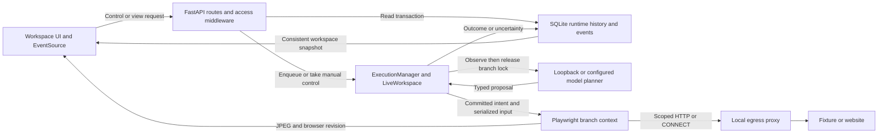
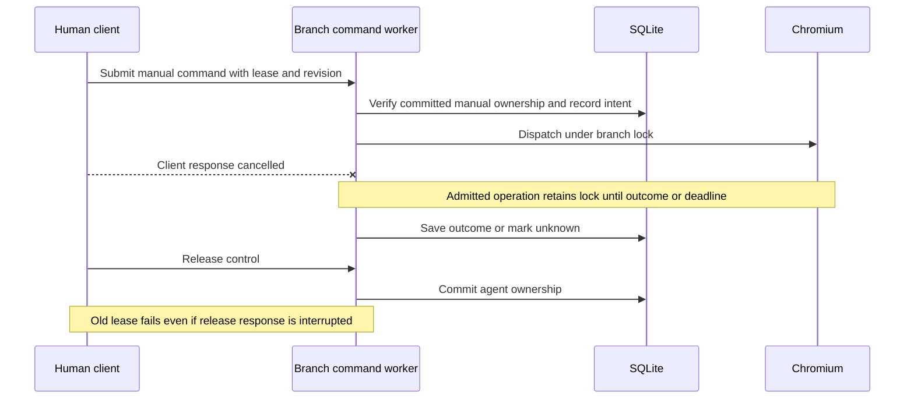

# THESUS workspace adversarial audit

November 6, 2026. The acceptance target is a local workspace where a human and an agent can safely alternate control of one browser. A separate target is the security of unattended automation against hostile, authenticated sites. The evidence supports the first target on the tested fixtures. The second remains blocked by demonstrated browser-side effects that escape command approval.

## Scope and method

The working directory is a source snapshot without Git metadata. This audit reconstructed the application from its Python, HTML, JavaScript, database, and test code. It began with the current 62-test suite, which passed in 98.94 seconds. The new scenarios then used real Chromium, isolated local fixtures, temporary profiles and SQLite files, and real Uvicorn where testing HTTP streams and the workspace UI. Some tests supplied scripted model decisions so that the browser, database, and control outcomes could be attributed to the injected event. Model behavior is assessed separately with actual local inference. No production accounts or third-party systems were used for destructive tests.

The test environment was Windows 11, Python 3.12.14, Playwright Python 1.64.1, and Chromium 145.0.7632.6. The machine used an Intel i7-10810U. Test setup and benchmark conditions matter. ASGI tests inject cancellation into the actual request task without a network transport. Browser requests still reach the fixture through Chromium. Uvicorn tests use actual loopback HTTP and two Chromium instances when exercising the outer UI.

The final regression suite passed all 92 tests in 135.57 seconds. This includes 30 adversarial cases added in the audit. JavaScript syntax validation passed. The preceding full run exposed the tied-timestamp cutoff issue. A deterministic counterexample then failed before the append-order correction and passed after it.

## Architecture reconstructed from source



`app/core/live_workspace.py` and `app/integrations/browser/playwright_adapter.py` own the live path. The frontend is a viewer and command client. It cannot establish ownership. SQLite records committed run state, approval metadata, and intent and result events. The live process holds branch locks, lease and revision state, cancellable model requests, and the raw pending command. `app/core/orchestrator.py` retains the older fake-adapter path for deterministic regression tests. That path exercises parts of the API and persistence but does not prove Chromium behavior. `app/core/task_groups.py` stages independent branch tasks, derives group progress from persisted states, and does not share browser context across members.



## Implementation traceability

| ID and original requirement | Code and independent evidence | Verdict and boundary |
| --- | --- | --- |
| R1 Real viewport, tabs, keyboard, pointer and scroll | `playwright_adapter.py`, `routes_workspace.py`, `app.js`. Real UI tests drove the same Chromium tab, typed and navigated, opened and closed a manual tab, and verified the visible result. | Verified on local Chromium. Frame comparison reduces stale pixel clicks. Arbitrary animation and all platform input combinations remain unverified. |
| R2 Task planning, navigation, observation and verification | `browser_planner.py`, `live_workspace.py`. Fixture and guided runs execute real commands. The 190-page probe used a scripted planner. Local Qwen completed one real redirection after manual intervention. A separate scripted planner completed a read-only HTTPS task on `example.com` under an explicit allowlist. | Verified integration on these paths. General model accuracy and the ability to infer intent from hostile content remain unproven. |
| R3 Human pause, takeover, edit, release and resume | `live_workspace.py`, `routes_control.py`. Synthetic sign-in, a second workspace tab, manual edits, return to the same tab, and guidance from the changed browser were exercised. | Verified on fixtures. Authentication testing used a synthetic local account. |
| R4 Exclusive control, cancellation and input deduplication | `live_workspace.py`, `test_adversarial_control.py`, `test_adversarial_recovery.py`, `test_browser_workspace.py`. Tests cover network-barrier takeover, client cancellation, expired lease, duplicate Resume, repeated command IDs, and a stale lease after an interrupted release. | Verified in one process. Multiple backend workers are outside the design. |
| R5 Exact approval and redirection | `live_workspace.py`, `playwright_adapter.py`, `test_adversarial_security.py`. Checked approval and explicit Pause independently. Native form tests vary destination, hidden values, encoding and click-time rewrites. | Verified for application commands and supported initial native form requests. Renderer scripts and follow-on requests remain a blocker for arbitrary authenticated sites. |
| R6 Real-time state, reconnect and replay | `routes_workspace.py`, `snapshots.py`, `app.js`, `test_adversarial_ui.py`. Forced a commit between reads, then tested atomic snapshots and reload. The 190-page run exercised old cursor recovery. | Verified for loopback SSE and HTTP backfill. SSE sends a bounded latest snapshot, with older events available through the history API. The implementation uses SSE and has no WebSocket workspace transport to interrupt. |
| R7 Durable tasks, checkpoints and branches | `orchestrator.py`, `checkpoints.py`, `repo_messages.py`, `repo_events.py`, `test_adversarial_recovery.py`. Forked an early checkpoint after later records existed and after autonomous page navigation. Restored a queued task and tested in-flight intent. | Verified for logical state and Chromium profile continuity. Exact DOM, volatile form contents and all tab histories can be lost on restart. |
| R8 Failure safety and long-running tasks | `execution_manager.py`, `live_workspace.py`, `scripts/adversarial_probe.py`. Injected Chromium crash, post-effect audit failure, model timeout, navigation timeout, and interrupted startup or shutdown. | Verified for these faults. Persistent disk exhaustion, whole-machine loss, and multi-hour resource stability remain unverified. |
| R9 Security, redaction and isolation | `app.py`, `playwright_adapter.py`, `egress_proxy.py`, `test_adversarial_security.py`. Spoofed Host, local redirects, synthetic credential flow, CONNECT close, and scoped artifacts exercised. | Partial. Local workspace is one principal. Site-side writes, same-origin redirects, server semantics, storage-at-rest protection and remote tenant separation remain separate concerns. |
| R10 Group tasks and per-task model selection | `task_groups.py`, `browser_models.py`, `test_task_groups.py`. Verified independent workers and profiles, group attention and completion, queueing and durable restart. | Verified locally. Model quality varies. Hardware and provider limits constrain actual parallel inference. |
| R11 Performance and observability | Viewport and SSE probes, browser events, group model usage and fork benchmark. | Local latency and selected resource costs measured. Cross-region transport, multi-tenant load and broad model success rates remain unmeasured. |
| R12 Broad autonomous and production acceptance | Deployment docs, previous model tests and current controlled integration audit. | Partial. No standardized WebArena run, production credential test or multi-tenant deployment was executed. |

## Findings and corrective evidence

| Severity | Observed failure and root cause | Correction and regression evidence |
| --- | --- | --- |
| P0 | A synthetic non-loopback peer supplied a loopback Host header and got a 200 on unauthenticated session creation. Host validation checks the requested virtual host, not the network peer. | No-token access requires an actual loopback peer. Host and origin checks still apply. Reproduced through an ASGI scope with a controlled remote address. Reverse-proxy deployments require a token and trustworthy proxy configuration. |
| P0 | An approved native form observed at amount `10` submitted `9000` after a hidden value changed. A synchronous click handler could also change the value after the last DOM check. | Bind the target to its supported native form metadata and values. Check one matching initial native request against the saved method, destination and encoded payload during dispatch. Pending and click-time rewrites produced zero fixture POSTs. The unchanged fixture submitted once with the expected payload. |
| P0, open | A page reached by an ordinary GET sent a background POST using an authenticated synthetic cookie without a workspace approval. An approved first-hop POST followed a 307 with another POST. | Treat these as production blockers for unattended hostile authenticated browsing. The narrow native guard stays in place. A blanket unsafe-method filter broke a read-only POST fixture and would leave other transports and side-effecting GETs. |
| P1 | Cancelling a request after Chromium began navigation returned control early. Cancelling after a release committed could instead leave an old in-memory lease accepted even though SQLite recorded agent control. | Admit a server-owned command under the branch lock, cancel it only while still waiting for admission, and drain an admitted operation through outcome recording. Validate durable manual mode and holder before using an in-memory lease, including before returning a cached command result. The delayed navigation test requires manual completion before Release. The commit-cancellation test requires 409 and a new lease. |
| P1 | Approving an action erased an explicit pause and sent the form. Duplicate Resume could also cancel a running model decision. | Persist an explicit operator pause independently of approval state. After approval, an explicitly paused task waits for Resume. Redundant Resume during active inference is a no-op. The form test observed zero POSTs before Resume and one after. |
| P1 | A navigation reached the fixture and timed out. The baseline later reported a generic failure and lost the distinction between failed and possibly applied. A rolled-back approval update could remove the live command while SQLite retained the pending proposal. | Preserve unknown outcomes in the intent journal, avoid automatic retry, and require review of the first new agent command after resuming. Publish or invalidate live proposals only after durable commits. Fault tests cover a real correlated POST followed by an audit-write failure, reject rollback, restart, and stale approval rejection. |
| P1 | A delayed JPEG appeared after the shared browser closed. A passive button shift preserved the command revision and directed a click at the wrong form. | Reject late viewer responses after closure or view change. The UI supplies a bounded frame proof for pointer clicks. The adapter compares fresh pixels near the pointer before dispatch. The shifted fixture returned 409 with zero POSTs to either endpoint. Raw coordinate API callers can omit proof and then own the coordinate risk. |
| P1 | A workspace snapshot paired old run state with a new message after a commit between reads. | Use a single SQLite read transaction shared by SSE and the browser's HTTP polling fallback. The forced interleave now gives a consistent snapshot. |
| P1 | A copied early checkpoint gained the final prefix cursor. A snapshot after passive navigation also stored an obsolete URL. Queued instructions and group scheduling could be stranded around a failure. | Preserve original checkpoint prefixes, save observed logical browser state and staged instructions, and correct scheduling and shutdown admission around the durable boundary. Tests use nested forks, live Chromium navigation, queued work and injected faults. |
| P1 | With tied timestamps, a later event with a lower UUID could enter an earlier fork or be skipped during cursor delivery. The count and stream cursors were ordered by wall time. | Use relative append order in SQLite for checkpoint prefixes and REST cursors. Preserve timestamps for replay and remap copied references. The controlled tied-time fixture verified the exact fork history and cursor delivery. |
| P2 | A silent upstream CONNECT retained a connection slot after the client disconnected. A fork hydrated all later history before discarding it. | End both tunnel legs when either closes while preserving the plain HTTP response path. Limit SQL history reads to the checkpoint prefix. Reproduced with TCP and with a 40,000-row excluded history tail. |

The recurring issue was an authority gap between two representations. SQLite could say one thing while memory, a JPEG, or a model decision still reflected another. Correctness improves when the check happens at the point of use. The branch lock orders competing application commands, SQLite establishes durable ownership and intent, and the browser supplies current evidence. None of those mechanisms can confer control over a third-party server's semantics.

## Architectural alternatives and decisions

Keep Playwright and the single branch command lane. A generic browser-use batch hook would bring back the exact-action review problem from the earlier pinned adapter. A remote desktop or hosted viewer could improve fidelity, but forwarding inputs through a second controller would require the same lease and revision checks. Playwright now offers JPEG screencast callbacks and frame timestamps, and Chromium's capture path still has an upstream pending-response navigation issue. Moving pixels to a push transport may help motion latency. It would not solve authoritative ownership, changed-target proof or post-dispatch uncertainty. [Playwright Screencast](https://playwright.dev/python/docs/api/class-screencast), [Chromium capture issue](https://github.com/microsoft/playwright/issues/43685), [prior transport comparison](research-browser-infrastructure.md)

Keep SQLite for the tested single-process installation. Explicitly pin each combined read instead of switching the entire database to a different transaction mode. Python's legacy SQLite transaction control can leave SELECT statements outside a repeatable read. WAL can allow writes while a reader is open, but its operational assumptions need separate deployment testing. A durable workflow engine might improve cross-worker scheduling. It would still need a recovery rule for side effects whose result is unknown. [SQLAlchemy SQLite transaction control](https://docs.sqlalchemy.org/en/20/dialects/sqlite.html#transactions-with-sqlite-and-the-sqlite3-driver), [SQLite WAL](https://sqlite.org/wal.html)

Keep the explicit application action journal and narrow first-hop native form guard. Stronger authorization for arbitrary authenticated sites requires a trusted connector or request-level policy with knowledge of actual business operations, redirect chains and server idempotency. Safe HTTP method semantics describe intended behavior. Servers can still attach side effects to GET. [RFC 9110 safe methods](https://www.rfc-editor.org/rfc/rfc9110.html#name-safe-methods), [Playwright network interception](https://playwright.dev/python/docs/network), [HTML form submission](https://html.spec.whatwg.org/multipage/form-control-infrastructure.html#constructing-the-entry-list)

## Performance and reliability

| Probe | Baseline | Corrected | What the comparison supports |
| --- | ---: | ---: | --- |
| Fork excludes 20,000 later messages and 20,000 later events, seven matched API trials | 654.36 ms median, full materialization | 21.29 ms median, append-order SQL prefix | The final comparison uses the same ordering in both variants. Copying a large included prefix still costs proportional time. |
| Workspace read with 180 events, ten requests per shape in steady state | Three concurrent GETs, 43.88 ms median | One consistent endpoint, 22.64 ms median | Loopback request shape comparison. It does not predict remote stream latency. |
| Coordinate click in warmed Chromium, six trials per variant | Caller-owned coordinates, 36.62 ms median | Frame proof, 86.83 ms median | The proof adds roughly 50 ms in this fixture. Timing starts after fetching the displayed frame. |
| 190-step task with two interventions and reconnect | 25.92 s | 26.34 s | Both loaded each requested page once. The difference is inconclusive for throughput. |
| SSE event creation to HTTP receipt, two pause events | 455.59 and 469.17 ms | 420.55 and 456.04 ms | Small samples near the polling interval. No general latency gain claimed. |

The corrected long run recorded 190 page requests, 192 observations, 201 durable events, eight checkpoints and 180 events in the bounded reconnect snapshot. REST recovered the older events. The reconnect payload was 97,006 bytes. Process-tree working set grew from about 85 MiB before the run to 959 MiB at completion, then dropped to 277 MiB after browser closure and 113 MiB after application shutdown. This suggests an accumulated browser resource cost. One run cannot establish a leak or a steady-state slope. The scripted planner used zero model tokens. The browser and inference probes report timings separately. [Operational measurements](adversarial-operations.md), [Persistence benchmark](adversarial-persistence.md)

### Actual local inference after intervention

An independent run used Qwen3 1.7B Q4_K_M through llama.cpp `b12138`, four CPU threads, one inference slot, an 8,192-token context, and reasoning disabled. The actual model opened `/details` in Chromium. The networked client paused the task, took manual control, navigated that same tab to `/cookie`, posted a revised user instruction, and returned control. The model answered **The heading says Cookie absent.** The fixture counted one visit to each page. The event order recorded initial planning, navigation, pause, takeover, manual input, revised instruction, release, a new plan, and completion. End-to-end time was 29.33 seconds with 1,292 input and 55 output tokens across two decisions. This is one local model and one intervention scenario.

To reproduce, start a local llama.cpp server with the chosen GGUF and run the probe from the workspace root. The probe starts its own fixture and Uvicorn listener with temporary storage.

```powershell
llama-server -m $workspaceGguf --host 127.0.0.1 --port 18178 --alias audit-qwen --ctx-size 8192 --threads 4 --parallel 1 --n-gpu-layers 0 --reasoning off
python -m scripts.adversarial_model --model-url http://127.0.0.1:18178/v1 --model audit-qwen
```

## Residual risk and engineering verdict

| Area | Assessment |
| --- | --- |
| Functional completeness | The local shared-browser workflow, logical recovery, groups and separate model profiles work on controlled fixtures. General task interpretation and broader browsing remain partial. |
| Correctness | The previously failing lease, approval, snapshot and fork cases have regression tests. The browser remains asynchronous between observation and dispatch. |
| Reliability | Timeouts and storage faults preserve an inspectable uncertain outcome. Non-idempotent effects can be accepted by a remote server before any local failure is observed. |
| Human-agent collaboration | Same-tab transfer, synthetic authentication, pause, stop and intervention worked in Chromium. |
| Browser-state consistency | One live context and a consistent runtime snapshot are validated. Frame proof is a recent pixel comparison, with a remaining capture-to-input interval. It can reject clicks on changing content. |
| Recovery robustness | Queued work and committed histories are durable. Exact browser restoration after process loss is outside the verified design. Users may need to re-enter transient data. |
| Security | Direct unauthenticated remote access and the tested first-hop native form rewrites are blocked. Arbitrary site-side effects, credential data outside the tested masks, and remote tenant isolation are open. |
| Efficiency | History-prefix queries and combined reads improved in the measured fixtures. Guarded input has a measured latency cost. Long-session memory needs further capacity measurement. |
| Maintainability | The changes preserve the existing deployment and APIs, adding bounded frame metadata and a consistent snapshot endpoint. Pillow is used to compare pixels around the pointer from Chromium-generated JPEGs. |
| Production readiness | Suitable for local supervised trials on controlled sites. Unattended operation on untrusted authenticated sites and multi-tenant production require additional authorization and deployment controls. |

Reproduce the targeted tests with `python -m pytest -q tests/test_adversarial_control.py tests/test_adversarial_recovery.py tests/test_adversarial_security.py tests/test_adversarial_ui.py`. Use the normal installation instructions and a separate temporary profile and database. The supporting reports specify fixture steps, injected failures and measurement limits. [Setup](../README.md), [Operations](adversarial-operations.md), [Persistence](adversarial-persistence.md), [Security](adversarial-security.md)
