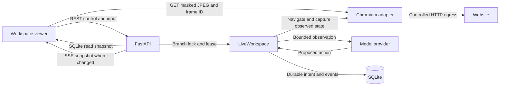

# Operational adversarial validation

Run on November 6, 2026 on Windows 11 build 26200, Python 3.12.14, Playwright 1.64.1 and cached Chromium 145.0.7632.6. The app ran on a real Uvicorn TCP listener, with temporary SQLite data and persistent Chromium profiles created in temporary directories. A second Chromium process opened the actual HTML, CSS and JavaScript. Loopback HTTP fixtures owned all site behavior and received synthetic credentials only. The operational planner was deterministic to make timing and state assertions repeatable. These runs exercise real navigation, screenshots, input, persistence, and control, with separate model evidence in the main audit.

## What the workspace actually does



The viewer derives progress from durable state, messages and events. Browser metadata, pixels and in-memory model activity remain separate observations of the live context. The controller verifies the branch, current lease, browser revision and, on UI pointer clicks, the displayed frame. The browser process remains the authority for tab, DOM, and authentication state. The application database cannot make website effects transactional.

## Operational acceptance

| Scenario | Expected | Observed and evidence |
| --- | --- | --- |
| Fresh task and live navigation | Browser appears, visits the requested route, and records an action | Real UI showed the synthetic sign-in page, JPEG and navigation activity. The existing guided demo and workspace viewer tests also passed in the four-test baseline run. |
| Pause and human takeover | Inference stops, one viewer gets control, another cannot acquire it | The fixture planner was canceled while waiting at sign-in. The first viewer obtained control, and the second viewer saw the page but received HTTP 409 on its takeover attempt. |
| Manual tabs and form input | Use the same browser, navigate a second tab, and keep authentication changes in the original task | The operator opened `/help` in a new tab, closed it, entered a synthetic password, and submitted `/sign-in` once. The authenticated page loaded once with the cookie required by the fixture. A reviewer note entered through the viewer appeared in the resumed planner's browser observation. |
| Release, reconnect and stop | Resume against modified browser, reconnect to the right state, stop a later turn | The viewer closed during inference. A reopened viewer showed the completed result, authenticated page and JPEG. A second task stopped through the UI and its pending planner call was canceled. The password did not appear in the planner observations, message API, or event API in this scenario. |
| In-flight agent action and takeover | Keep exclusive browser ownership and drain the operation | The existing real-browser in-flight navigation test passed in the four-test baseline run. An external effect that has already been admitted may still take effect, and the system can require inspection before resuming. |
| Pause during approval | Keep authorization and execution separate | The UI displayed the explicit pause. Approving hid the approval card and left the task paused with zero submissions. Resume produced exactly one POST to the authorized form and zero to the other form. |

The final guarded GUI and snapshot run passed seven tests in 43.48 seconds. This includes five operational test cases and the existing guided demo and shared viewport. JavaScript syntax checking passed. The synthetic sign-in verifies ordinary cookie-based form authentication. Third-party SSO, passkeys, native dialogs, real account policy, public network conditions, and unattended long-term operation were outside this pass. [Operational tests](../tests/test_adversarial_ui.py)

## Reproduced failures and corrections

### OP-01 Delayed frame after browser close

**P1.** Hold a valid JPEG response at the viewer, close the browser through the UI, and release the old response after the viewport is hidden. The browser remained closed on the server, but the DOM observer caught the old pixels appearing again. The regression failed before correction in 6.44 seconds and passed after correction in 4.54 seconds. `refreshFrame` originally checked only the active session after decoding. The frame now must also match the live browser metadata, command version, and active tab. Switching tabs clears an image from the previous tab. A late response cannot restore an image after the browser has closed. [Regression](../tests/test_adversarial_ui.py), [viewer implementation](../app/ui/static/app.js)

### OP-02 Snapshot mixes separate commits

**P1.** Suspend a real stream request after reading its session state, then commit a new instruction from a second HTTP request and resume the stream. WAL in the test lets the writer commit while the read is suspended. The baseline emitted `idle` from the older read with the newly committed message. The controlled baseline failed in 1.15 seconds. The stream and the single `GET /sessions/{id}/workspace` fallback now read the bounded state, messages and events in the same SQLite read transaction. Both routes returned the old consistent snapshot first and the new consistent snapshot afterward. The test's concurrent write committed while the reader was suspended, which also checks that no branch-control lock wraps the read. The UI uses that same endpoint for its initial and fallback state, and ignores a fallback response that lost a race with a newer read or stream update. SQLite legacy transaction handling explains why a SQLAlchemy session alone did not isolate the SELECT statements. [Regression](../tests/test_adversarial_ui.py), [snapshot routes](../app/api/routes_workspace.py), [SQLite transaction behavior](https://docs.sqlalchemy.org/en/20/dialects/sqlite.html#transactions-with-sqlite-and-the-sqlite3-driver)

### OP-03 Same-revision layout change redirects a manual click

**P1.** Serve two buttons with distinct synthetic POST destinations, capture the page, and swap their positions from a delayed fixture response without navigating. The old frame and shifted page shared the same revision. Clicking at the old position returned HTTP 200, recorded zero POSTs to the intended endpoint and one POST to the other endpoint. The current viewer sends the frame ID seen at pointer-down. The adapter obtains a fresh masked JPEG and compares the region near the pointer before dispatch. The identical fixture now returns HTTP 409 and records zero POSTs to both destinations. The opaque frame ID is independent of the browser generation. The check may reject legitimate clicks on a changing image. A renderer change after comparison, a visually unchanged semantic change, and a passive focus change before typing remain risks. A direct API coordinate caller can omit the frame ID and assumes responsibility for freshness. [Layout probe](../scripts/adversarial_probe.py), [adapter](../app/integrations/browser/playwright_adapter.py)

## Measured baseline and stress run

The five-round collaboration baseline used the existing `benchmark_workspace` runner with 10 JPEG requests per round. It ran while other test processes were active. It completed five takeovers and resumptions with zero failures across 10 manual inputs. Medians were 2,278.94 ms to the first agent observation, 86.23 ms for takeover, 60.70 ms for the click command, 131.20 ms from click to a changed JPEG HTTP response, and 159.37 ms from release to completion. Fifty JPEG responses had a median payload of 19,476 bytes and median HTTP latency of 12.00 ms. Serial HTTP requests include cached repeats and cannot be counted as displayed frames. Median sampled process-tree working set was 597.58 MiB. This run used a deterministic planner and recorded zero model tokens.

The separate sustained baseline completed 190 pages in 25.92 seconds. The fixture recorded exactly one request to each numbered page. The planner made 192 page observations, including the two fresh observations after pause, takeover and release. It retained a maximum of eight history entries and 121 observed accessibility characters per page on this small fixture. Eight checkpoints and 201 durable events were present. A stream reconnect with an outdated snapshot ID returned the latest 180 events in 96,982 JSON bytes, and REST cursor backfill reconstructed all 201 IDs in order without duplication. Two pause events arrived over SSE 455.59 and 469.17 ms after event creation. This is timestamp-to-HTTP observation on loopback and excludes a browser paint measure. Process-tree working set rose from 82.47 MiB before startup to 710.62 MiB at record 63, 819.68 MiB at 126 and 916.91 MiB on completion. It fell to 260.79 MiB after closing the browser. This establishes resource accumulation during one short run and partial reclamation after close. It does not isolate Chromium history, renderer processes, Python allocations, or establish a memory leak.

## Matched post-fix probes

| Workload | Samples per path | Before path, median and max | Corrected path, median and max |
| --- | ---: | ---: | ---: |
| One bounded workspace read with 180 events | 10 | 43.88 and 74.43 ms for the prior shape of three concurrent GETs | 22.64 and 25.94 ms for one consistent GET |
| Coordinate click dispatch over HTTP | 6 | 36.62 and 43.91 ms without frame checking | 86.83 and 99.39 ms with a frame ID and fresh masked capture |

Each pair ran against the same warmed application and fixture, alternating request order to reduce warm-up bias. The read comparison used equivalent response bounds and checked that the steady-state JSON matched. The click comparison captured a frame before both paths and timed only the POST. The safety check therefore added 50.21 ms to the observed median on this fixture. The samples describe loopback behavior under shared test load and are insufficient for a tail-latency estimate or a production capacity claim.

The 190-step post-fix run took 26.34 seconds, with 190 unique page requests, 192 observations, eight checkpoints, 201 durable events, and a 180-event reconnect payload of 97,006 JSON bytes. Its two pause events arrived 420.55 and 456.04 ms after event creation. Working set samples in MiB were 84.70 before startup, 743.68 at record 63, 853.71 at record 126, 958.70 on completion, 277.30 after browser close and 113.18 after application shutdown. Browser and inference load from concurrent audit activity was not controlled, and the workload uses one tiny site. The change in total duration and working set between runs is inconclusive. [Probe source](../scripts/adversarial_probe.py)

## Streaming trade-offs and residual scope

The present split between bounded state snapshots and masked image fetches kept the corrections small. Each live snapshot currently serializes recent history, so the measured final 97 kB payload is a reason to profile an event-delta protocol if production workloads justify it. A delta design would need a monotonic replay cursor and explicit authoritative state after reconnect. A faster image transport would still need frame identity, branch ownership and click validation.

Playwright's current `page.screencast.start` exposes a JPEG callback with a browser presentation timestamp and the capture viewport dimensions. These fields could improve transport latency measurement and sizing. Its documented frame arguments lack the locator masks exposed by `page.screenshot`, and the documented `fps` option applies to file recording. The active stream may also override requested capture dimensions. Replacing the current image path would require verified redaction, backpressure and bounded retention. The lower-level CDP protocol exposes capture and acknowledgments. A recent upstream issue records a request to expose Chromium's frame-in-flight control through Playwright, so treat browser-specific streaming tuning as an experimental alternative. This audit did not benchmark a replacement transport. [Playwright screencast API](https://playwright.dev/python/docs/api/class-screencast#screencast-start), [screenshot masking](https://playwright.dev/python/docs/api/class-page#page-screenshot-option-mask), [CDP Page protocol](https://chromedevtools.github.io/devtools-protocol/tot/Page/#method-startScreencast), [Playwright issue 42809](https://github.com/microsoft/playwright/issues/42809)

## Reproduce locally

Use the repository's Chromium setup and set `BROWSER_EXECUTABLE_PATH` if selecting a compatible cached executable. The script uses `psutil` when available for process-tree measurements. The fixtures bind to dynamic loopback ports and use temporary data.

```powershell
python -m pytest -q tests/test_adversarial_ui.py
python -m scripts.benchmark_workspace --rounds 5 --frames 10
python -m scripts.adversarial_probe --pages 190
python -m scripts.adversarial_probe --passive-shift
python -m scripts.adversarial_probe --click-proof-cost
```
