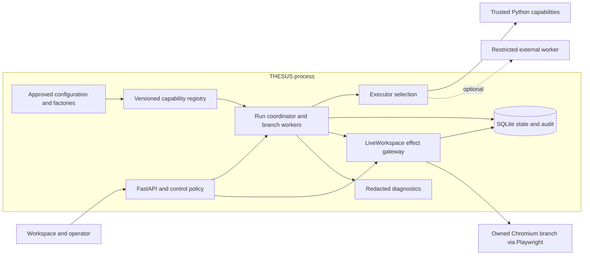
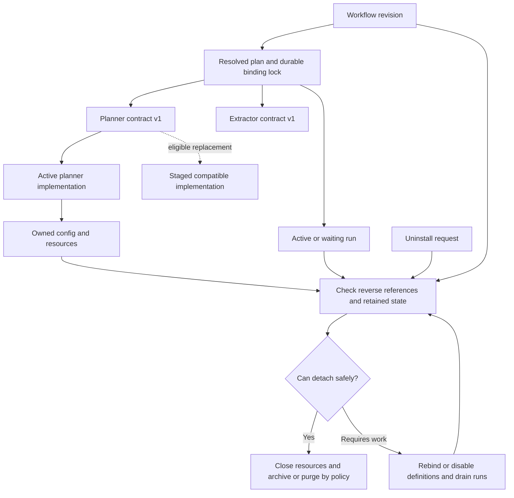
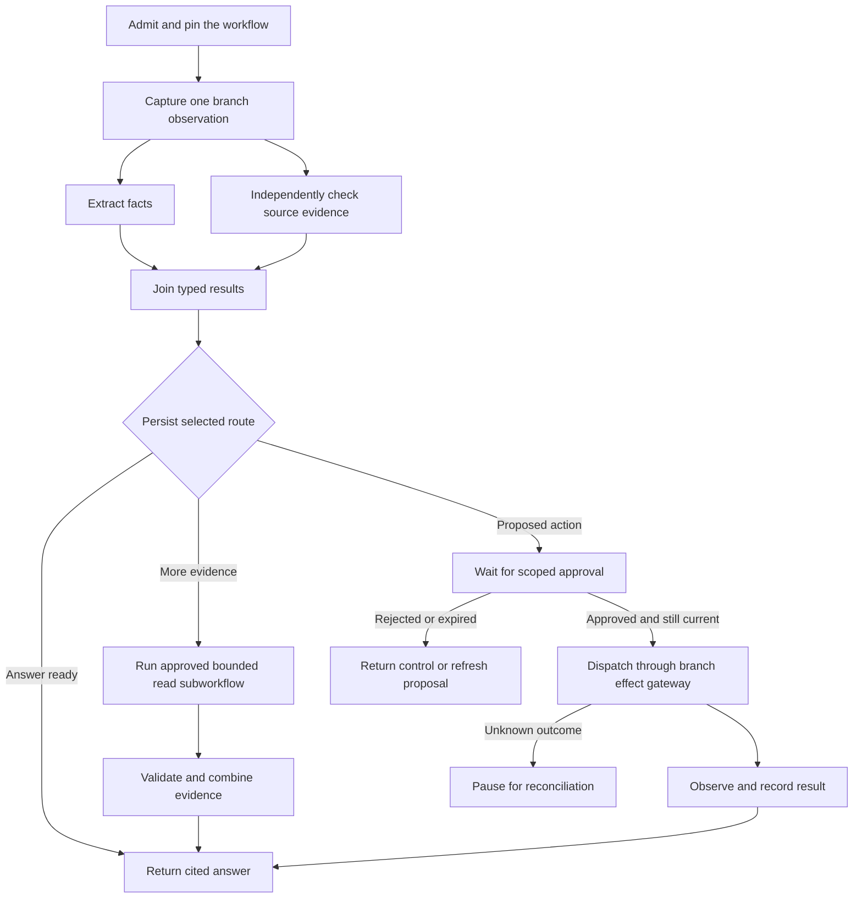

# THESUS modular execution design

Proposed interfaces and semantics for the local workspace. The first slice needs a registry, two compatible implementations and one configurable workflow. Graph expansion, third-party discovery and isolated execution can follow without changing that contract. [Research and alternatives](modularity-research.md), [Roadmap and acceptance criteria](modularity-validation.md)

## Boundaries

| Responsibility | Placement |
| --- | --- |
| Capability and registration | Plain Python protocols and serializable contracts. App assembly supplies built-in factories. An immutable registry generation holds validated, enabled bindings. |
| Orchestration and execution | Existing branch workers wake the run coordinator. It loads a pinned plan, claims ready nodes, enforces budgets and dispatches through an in-process executor. Add a restricted worker executor when needed. |
| State | Existing repositories and SQLite remain the source of truth for branch state, approvals and browser intent. Add small run and node records for resumable chains. Artifacts remain scoped by run and branch. |
| Control and observation | Existing API, workspace UI and browser ownership stay authoritative. Add configuration, lifecycle checks and redacted diagnostics at the same boundary. Existing SSE and replay present run status and history. |



## Component contracts

Bind nodes to a capability such as `thesus.browser.plan` with contract major `1`. A binding names an implementation such as `thesus.guided`, its exact release and artifact digest, configuration digest, execution profile, and granted permissions. Workflows depend on the contract. Each run records the exact binding. Keep contract, implementation, workflow and persisted-state versions separate.

| Record | Required content and enforcement |
| --- | --- |
| Capability contract | Stable ID and major version, input and output schemas, effect category and failure vocabulary. For browser planning, input is a bounded goal plus a scoped, revisioned observation and recent summaries. Output is a typed answer, help request, or command proposal for the host to validate. |
| Implementation manifest | Implementation ID and version, artifact hash, exported contract versions and schema digests, configuration schema, explicit required or optional capability dependencies, supported execution profile, resource requests, state schema and ownership, required permission scopes. Operator configuration grants permissions separately. |
| Invocation | Run, node, attempt and stable operation IDs, validated typed inputs, deadline, cancellation and trace context. In-process providers receive scoped interfaces through injection. Worker calls use JSON and opaque artifact references resolved by the host. Live browser handles, database sessions, ambient secrets and mutable global state stay with the host. |
| Result | Success with validated output and bounded usage metrics, or a typed failure with safe code, retry classification and effect certainty. Large outputs use scoped, size-limited artifact references with retention. Treat returned content as untrusted data. |
| Resource lifetime | Scope instance state, clients, connections, child processes and temporary files to a run or registry generation. A stateful implementation declares namespaced storage, schema, retention, export and migration behavior. The host closes resources after draining; it owns cross-capability state. |

Illustrative Python seam. Generated or handwritten types at the edge map to the versioned JSON schemas. An executor adapts transport and deadlines without adding hooks to every call.

```python
class BrowserPlanner(Protocol):
    async def decide(
        self, request: PlanRequestV1, context: InvocationContext
    ) -> PlanDecisionV1: ...

class Executor(Protocol):
    async def invoke(
        self, binding: ResolvedBinding, request: Invocation
    ) -> InvocationResult: ...
```

- Use strict schema checks at configuration load, plan activation, invocation and output boundaries. Prefer additive optional fields with defaults for same-major evolution, and test old callers and stored payloads. Breaking shapes, permissions, side-effect or failure semantics require a new major. A version range never overrides a failed compatibility fixture.
- Initial effect categories are `pure`, `external_read`, `effect_proposal` and host-mediated `external_write`. A read still requires egress, credential, disclosure and rate policy. The host assigns these classifications to reviewed implementations and calls. Workflow authors and models cannot declare a more permissive class.
- Core node states include `ready`, `running`, `waiting_for_review`, `succeeded`, `failed`, `skipped`, `cancelled` and `uncertain`, plus a dependency wait before admission. Safe failure codes distinguish invalid input or output, incompatible version, permission denied, capacity, transient provider failure, deadline, cancellation and unknown effect. A timeout alone supplies no evidence about external state.
- Keep application audit and telemetry separate. Log version and schema IDs, node transitions, queue and run time, retry, resource and cancellation outcomes. Store approval and intent evidence durably. Export only allowlisted trace attributes, redact at boundaries, and keep per-run IDs out of metric labels. Treat evolving GenAI conventions as an export mapping. [OpenTelemetry GenAI agent spans](https://github.com/open-telemetry/semantic-conventions-genai/blob/main/docs/gen-ai/gen-ai-agent-spans.md)

An unsuccessful invocation can use the following wire shape. The host derives the effective retry decision from policy and recorded intent. A worker's proposed classification carries no authority.

```json
{
  "wire_major": 1,
  "operation_id": "run-42:extract",
  "attempt": 1,
  "status": "failed",
  "failure": {
    "code": "provider_unavailable",
    "retry_class": "transient",
    "effect_certainty": "none"
  }
}
```

## Registration, dependencies and removal

1. **Stage.** In version one, install or configure known factories at deployment. Later discover independently packaged trusted plugins from a dedicated entry point group. Inspect metadata and verify provenance, exact artifact and allowlist before import or spawn. Package locking resolves installation dependencies outside the process. The host resolves capability dependencies independently. Use a separate worker environment when package requirements conflict.
2. **Resolve.** Select by explicit binding or a single operator-configured default. Reject ambiguous defaults, missing required dependencies, incompatible majors, unsupported profiles, cycles and permission escalation. Missing optional dependencies must map to a declared skip or fallback that satisfies the downstream schema. Bound dependencies by explicit scoped interfaces. Perform schema, budget and contract tests and warm-up before activation.
3. **Activate.** Publish the complete validated registry generation atomically. Run admission reads that generation and commits the immutable workflow revision, plan digest, binding closure and config digests before queueing. A failed validation leaves the previous generation active. Store nonsecret config and credential references with the lock. Recheck current authorization at dispatch even for older pins.
4. **Replace or disable.** New admissions use the new generation. Pins stay valid for authorized existing runs, including runs waiting for input. For trusted in-process code, prefer a planned process restart for package changes. Side-by-side worker versions allow live routing changes. Draining has an operator-defined deadline and a visible blocked-run list. A security revocation fences old admissions and new invocations immediately. Quiesce admitted effects or classify their outcomes as uncertain.
5. **Uninstall.** Produce a reverse-reference report across enabled definitions and defaults, dependency closures, waiting and active runs, and owned artifacts and state. Atomically bind replacements, disable affected definitions with diagnostics or block uninstall until references clear. A pinned run can finish, be explicitly cancelled and reconciled, or migrate from a validated checkpoint after approval. Retain historical implementation/version references and a decoder or export for historical records. After drain, stop resources, remove credentials, caches and schedules, then archive or purge owned state under retention policy. Verify that no worker, lease, profile, dangling enabled workflow or live secret remains. Active history references carry descriptive metadata only.
6. **Roll back.** Re-point future admissions to the prior compatible generation. Existing runs stay pinned or move through a tested state conversion with explicit provenance. Prefer expand-and-contract storage changes, a verified backup and retained readers, with destructive cleanup delayed until the rollback window closes. Refuse a rollback when the former version cannot read committed state. Restore from backup only through a reconciled maintenance procedure that accounts for external effects since the backup.

Serialize configuration publication, binding acquisition and uninstall checks. Persist lifecycle and workflow status together where they affect future admission. At restart, reconstruct approved bindings from deployed artifacts and durable pins. A missing binding stops that run with a repairable reason. It never silently picks the newest implementation. Startup tests must cover both new and existing workspaces.



## Workflow and agentic chain specification

A workflow revision contains its input and output types, named nodes, dependencies, explicit input mappings from validated predecessor outputs, branch rules, resource budgets and join policies. A node identifies a capability and required contract major or a versioned child workflow. Bindings and execution profiles come from operator policy, with optional user selection among approved alternatives. User-defined workflows are declarative and prevalidated. User-defined Python requires separate deployment and trust review.

For the first experiment, a workflow can take a previously captured observation and run one extractor. The capability selection in this specimen stays the same for both implementations. The definition's revision and the registry's exact implementation lock are recorded separately at admission.

```json
{
  "workflow_id": "thesus.invoice.extract",
  "revision": 1,
  "input_schema": "thesus.browser.observation@1",
  "output_schema": "thesus.invoice.fact@1",
  "nodes": [
    {
      "id": "extract",
      "capability": "thesus.invoice.extract_fact",
      "contract_major": 1,
      "depends_on": [],
      "inputs": { "observation": "$input" }
    }
  ],
  "output_from": "extract",
  "deadline_ms": 2000
}
```

| Pattern | Execution semantics |
| --- | --- |
| Sequential | Admit a node when its selected predecessors are terminal and the required outputs exist. Validate the mapped input before taking resources. Persist output and readiness changes atomically. |
| Parallel | Fan out independent bounded work with separate state and execution slots. Declare `all` or `collect` joins. `all` requires success from every selected predecessor and can request cancellation of siblings. `collect` returns typed per-child outcomes in stable node ID order. The join waits for in-flight effects to drain or reconcile. Missing required inputs cause a typed block. |
| Conditional and optional | A typed router returns one label from a declared set. Evaluate on validated outputs, persist the chosen label before admitting work, and mark unselected nodes or edges skipped. The join considers selected predecessors only. An optional stage declares how skipped outputs are represented or substituted. |
| Dynamic composition | Start with a static DAG plus bounded fan-out of an approved template. An optional planner can propose new instances of known templates, with allowed inputs, stable child IDs and a maximum expansion count. The coordinator checks schema, cycles, depth, capabilities, permissions and budgets. It persists the normalized expansion before scheduling any node. Replay reads the recorded expansion. Use a bounded state transition loop for the browser planner and observation cycle. |
| Nested and multi-agent | A child receives a narrowed input, resource budget, deadline and inherited cancellation. It returns a typed summary or proposed work. Specialists may run independently and join through a coordinator with explicit conflict rules. The parent owns the final decision and the effect gateway. Independent browser research runs use separate branches and profiles. |
| Event-triggered | Start from explicit API requests and committed state changes. A durable trigger uses a unique source event key plus workflow revision and scope. Treat callbacks and queue wakeups as hints; startup and bounded reconciliation rescan persisted ready work. Add outbox delivery only for external consumers with a durable delivery requirement. |
| Human in the loop | Persist the proposed action identity, current generation, exact parameters or digest, scope and expiry. Wait without holding a model or worker slot. Approval is checked at dispatch against current authority and the live observation. A browser branch may retain its context and capacity slot while waiting. On restart, browser approvals bound to volatile handles expire and are recreated after fresh observation. |
| Runtime configuration | Pin structural settings, versions and schemas. At node boundaries, accept an authorized patch only to fields the contract marks mutable, with validation, revision check and audit. Record effective values per invocation. Lowering a budget cannot authorize additional effects. Live permission revocation takes precedence over the pin. |

An example chain starts on an approved fixture URL and asks for a summary with a source. It captures one bounded observation, runs two read-only specialists in parallel over that snapshot, and joins them deterministically. A router chooses to finish, start an approved bounded read subworkflow, or ask the user to review a proposed browser command. A second extraction implementation can replace the first through configuration. For a predictable page, use a deterministic extractor and router. Add a specialist only if the comparison improves evidence quality within the same budgets.



## Dispatch, recovery and resource policy

Use the existing single-process branch lock and generation checks for the live browser. Model inference, pure transforms and independent branch work may overlap. A planner or worker proposes effects through the host. Never hand a third-party planner a live browser, authenticated profile path or raw Playwright client. Recheck ownership, scope, current policy, pinned binding and observation revision at admission. Keep takeover and manual browser input on the same control path. A future remote browser owner needs an enforced fencing token at its command ingress plus a single owner of the profile.

For durable chains, start with a run record and one record per logical node instance. The run stores scope, definition revision, resolved plan and lock, status, limits, and optional unique trigger key. The node stores its stable path, operation ID, status, attempt, bound generation, output or artifact reference, and effect journal reference if applicable. Use a uniqueness constraint on run and node path, and a conditional status/attempt update when claiming or completing a node. Keep transitions in the existing event history where it already supports replay. Publish wakeups only after commit.

Persist the node claim and increment its attempt number before invoking work. Update node result and successor readiness in one transaction. The journal for external effects is authoritative and associates the workflow operation ID with the browser intent. Give each admitted command its own operation ID. A crash before a recorded effect intent allows safe recovery from the last node boundary if no dispatch can have occurred. A recorded intent with no confirmed result is ambiguous, including a crash between intent commit and dispatch. A durable confirmed result can settle the node after restart without repeating the effect. An unknown result pauses that effect path for review or authoritative reconciliation. A node deadline, broken socket or worker death never proves that a write was absent.

Retry pure or classified safe read work within an attempt cap, deadline and jittered backoff. Retrying writes requires a provider-enforced idempotency key or authoritative evidence that repetition is safe, plus current approval and policy where applicable. Keep the operation ID stable across retries and reject stale replies by attempt, owner generation and binding. A fresh authorized action after uncertainty gets a new operation ID only after reconciliation. Do not use retries to substitute for compensation, which is a separate effect with its own authorization and failure outcome.

Use bounded queues, per-run fan-out and payload limits, separate browser/model/CPU-worker quotas, and a fair ready queue across admitted runs. Release worker slots during human waits, retry delays and dependency waits. Apply a finite drain deadline to admitted effects. Cooperative tasks receive cancellation. A worker can be terminated after grace, with its admitted effects reconciled as necessary. Streams are bounded progress or data channels with sequence numbers, backpressure and drop policies for expendable telemetry. Commit final typed outputs separately. Do not stream unreviewed commands into the effect gateway.

Start with immutable inputs and per-node outputs. A scoped memory capability can expose retrieval and explicit writes with namespace, size, retention and provenance. Use a host-controlled versioned update or deterministic reducer for shared state. A state-backend swap requires checkpoint round-trips, stable ordering and atomic transitions, plus export/import and isolation tests. Keep short SQLite transactions, including under parallel load, and profile lock waits before changing databases. If evaluating WAL, keep the database on local storage and verify the SQLite library used by Python includes the WAL-reset fix. [SQLite WAL and fix details](https://www.sqlite.org/wal.html#the_wal_reset_bug)

## Integration choices

| Method | Use and ownership |
| --- | --- |
| Direct dependency | Wrap a stable, narrow Python API behind a local capability. Pin dependencies and hide vendor objects in the wrapper. Works for trusted libraries with a compatible environment. |
| Adapter or plugin wrapper | Translate typed inputs, outputs, cancellation, side effects and errors. Keep vendor lifecycle and callbacks inside the wrapper. Good first route for planner and extractor alternatives. |
| Selective adaptation | Trace the behavior to a pinned source, retain provenance and notices, review applicable licenses, and test the smallest reusable mechanism. Prefer upstreaming generic fixes to reduce divergence. |
| Independent implementation | Use the published protocol and public behavior when the contract is simpler than bringing in a runtime. Document sources and verify interoperability. Use authorized artifacts and environments only. |
| Process or protocol adapter | Select for conflicting dependencies, cross-language reuse or constrained trust. Pin worker artifact and handshake, bound framed requests and output, enforce deadline and cancellation, supervise child trees, and restrict OS privileges and egress. An MCP tool wrapper further pins reviewed tool schemas and server identity. |
| Service | Select when a team already owns a remote implementation or it needs a separate deployment or resource pool. Add authenticated transport, scoped service credentials, quotas, version negotiation and explicit failure/recovery semantics at the adapter. |
| Fork | Require a unique tested capability, named maintainer, upstream merge and patch cadence, license obligations, release and rollback procedure, and a narrow interface that allows a future upstream return. Record diffs against a pinned base. |

External workers get the minimum filesystem, network, credential, CPU and memory access required by their profile. Use a separate environment to address dependency conflicts and an enforced OS or container boundary for untrusted code. A plugin importing into the app inherits host privileges. A plain child running as the same user can still read data that user can access. Keep plugin requests for browser and secret-backed operations mediated. [Plugin and isolation evidence](modularity-plugin-evidence.md)

## Extension paths

- A better model, extractor, retrieval store or planner can enter as a second implementation of an existing capability. If it needs extra input, start with an optional field that existing callers can omit. If the semantics change, add a new capability major and migrate selected definitions.
- A third-party tool can enter through an isolated worker or an existing protocol. Its reviewed output can feed multiple chains. Its internal state, credentials and installation remain separate from the core. Removing the binding requires a compatible replacement or deactivating the workflows that use it.
- A new orchestration runtime can own a bounded subworkflow whose result fits the existing node contract. For a top-level migration, choose one authoritative runner per execution, migrate a read-only workflow first and give older pinned runs an explicit drain or supported transfer path.
- A new browser backend requires the broader live-session contract. Use the fixture suite to validate observation freshness, exact dispatch, streaming, exclusive ownership, profile and artifact scope, and restart. Hold authenticated profile transfer to an explicit, tested migration.
