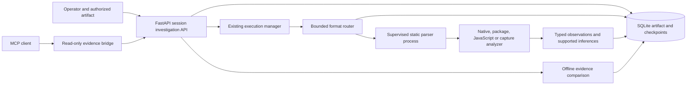
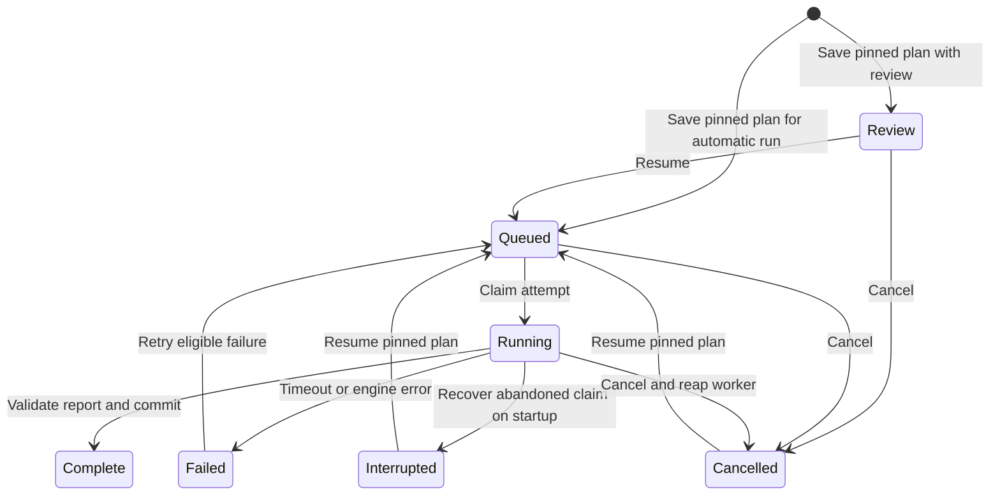

# THESUS reverse-engineering subsystem

Decision record and research gate, November 6, 2026. The target is the THESUS browser workspace in this directory. This working copy has no Git metadata. The design targets its supported single-process deployment on a local Windows workstation, with portable static analysis engines where tested.

## Workspace map

| Existing boundary | Integration decision |
| --- | --- |
| FastAPI composition, loopback peer check, token authentication, host and origin checks | Add opt-in investigation routes under an existing session. Apply the workspace access middleware even when the fake browser is selected. An upload explicitly attests ownership or authorization. [App assembly](../app/app.py), [API router](../app/api/router.py) |
| In-process `ExecutionManager`, branch ownership, action approval and recovery | Reuse the scheduler class for investigation work keyed by session and investigation. Keep the browser's branch lock, approval policy and dispatch journal on the browser path. An artifact investigation cannot acquire a browser or issue a browser command. [Scheduler](../app/core/execution_manager.py), [Browser control](../app/core/live_workspace.py), [Recovery](../app/core/recovery.py) |
| SQLite, SQLAlchemy, session-scoped repositories and logical checkpoints | Use an additive investigation table with immutable artifact digest, plan, attempt, state, bounded audit and evidence. Reuse the connection factory and existing app lifespan. Keep analysis outside transactions. [Database initialization](../app/db/init_db.py), [Session repository](../app/db/repo_sessions.py), [Checkpoint semantics](../app/core/checkpoints.py) |
| Browser planner, local or hosted model adapters, recent decision summaries and replay | Current browser models consume a limited observation and produce one typed decision. Existing memory is scoped persisted state and bounded history. There is no general sandbox, vector store, tool router or durable distributed runner to inherit. Keep artifact bytes and evidence out of model prompts in the initial implementation. [Planner](../app/agents/browser_planner.py), [Task groups](../app/core/task_groups.py), [Replay](../app/core/replay.py) |
| Chromium profile, artifact and egress controls | Separate original artifacts from browser profiles. Static inspection consumes uploaded bytes. It cannot fetch a recorded URL, execute an upload, attach to a process, extract files to paths, or use a live account. Parser subprocesses limit failure propagation and wall time. Same-user processes do not supply hostile-code containment. [Browser threat model](../ARCHITECTURE.md#threat-model) |
| Existing regression and adversarial suites | Preserve normal browser and fake entry points. Add controlled fixtures for engine output, cancellation, restart, input limits and session scoping. The existing workstation has Python 3.12, Node 24, Playwright and Chromium, with about 4.4 GiB free RAM in the observed snapshot. Java, Ghidra, WSL and a native compiler were unavailable on the original command path. [Existing validation](validation.md), [Prior modularity baseline](modularity-validation.md#baseline-rerun) |

## Alternatives and decision

| Approach | Capability and evidence | Operating and security costs | Decision |
| --- | --- | --- | --- |
| Direct upstream REA integration | A broad analysis orchestrator with native providers and artifact-specific workflows. It is a useful implementation and benchmark reference. | Provider availability varies by host and installed tools. Its active-target and evidence semantics would need a careful adapter to fit per-investigation authorization, stage recovery and scoped storage. | Study and compare. Keep outside the THESUS process. [Upstream REA](https://github.com/morluto/rea) |
| REA via MCP | A replaceable protocol connection can expose named tools and structured output. Mature options span newer stateless MCP and older initialization-based servers. | Tool discovery grants no authority. Backend sessions, path transfer, transport limits and precise tool allowlists still need enforcement. Attaching a dynamic provider can widen privileges considerably. | Publish a narrowly scoped read-only MCP bridge first. Admit external analyzers only after a separately isolated trial. [MCP specification changes](https://modelcontextprotocol.io/specification/2026-07-28/changelog), [MCP tools](https://modelcontextprotocol.io/specification/2026-07-28/server/tools) |
| Independent RE agent or a single full analysis suite | Agent projects explore autonomous hypotheses and tool use. Ghidra headless can import an image, run analyzers and scripts, and supply decompiler output. | Agent evaluation can conflate reasoning, preprocessing and tools. Ghidra needs Java, higher startup and memory budgets, and project-state lifecycle. One suite does not cover the full artifact mix. | Use Ghidra as the first candidate for a deeper native adapter when a test needs function recovery. Trial independent agents on the same evidence and permissions. [Headless analyzer](https://github.com/NationalSecurityAgency/ghidra/blob/master/Ghidra/RuntimeScripts/support/analyzeHeadlessREADME.md), [DecompileBench](https://arxiv.org/abs/2505.11340) |
| Hybrid analysis layer using selected libraries | Capstone provides bounded disassembly. PE and ELF format libraries can map entry addresses back to file offsets. Tree-sitter supplies structured JavaScript syntax nodes. ZIP and sanitized HAR inventory can use the standard library. | THESUS owns the narrow routing, provenance and recovery contracts. These tools do not prove runtime behavior. Artifact bytes and parser outputs need bounds and untrusted-data treatment. | **Select this architecture.** Start with deterministic routing and permission-scoped evidence. Add deeper engines behind the same typed result only when a fixture demonstrates a gap. [Capstone 5.0.9](https://pypi.org/project/capstone/5.0.9/), [PE format](https://learn.microsoft.com/en-us/windows/win32/debug/pe-format), [ELF program headers](https://gabi.xinuos.com/elf/07-pheader.html), [Tree-sitter JavaScript 0.25.0](https://pypi.org/project/tree-sitter-javascript/0.25.0/) |
| Custom parsers and agent framework | Complete control over hosting and contracts. | Reimplements intricate decoders and repeats existing scheduling and persistence. Increases the validation burden for malformed files and semantics. | Implement the application boundary and evidence contract. Reuse decoders and the existing scheduler. |

The feasibility gate passed on Windows and Python 3.12.14. The pinned Capstone wheel decoded the two known instructions in an x86-64 fixture, and the pinned Tree-sitter parser and grammar produced a valid syntax tree for a literal Electron IPC fixture. The PE and ELF readers imported successfully. This establishes a usable local starting point. Evaluation criteria are a correctly scoped authorization, a known observation with reproducible coordinates, a separately labeled inference, safe cancellation and restart, a fixture-level verification oracle, and no target execution. The simpler baseline is inventory-only processing of the same artifacts. Compare the external REA path separately on the overlapping artifact and disclose different output scopes. Native decompilation quality and open-ended autonomous planning require separate trials.

## Architecture and roadmap



1. **Minimal integration.** Admit a bounded upload to an existing session, compute its SHA-256, and select a static format-specific plan. Expose status through the usual app. Prove a complete run with the synthetic fixture.
2. **Persistence and supervision.** Commit the identification checkpoint before analysis. Provide an optional review stop, explicit resume, cancellation, interrupted startup recovery, evidence identities and operator-visible audit. Require stale or cancelled attempts to leave durable outputs unchanged.
3. **Multiple engines.** Verify native layout and bounded disassembly, package and JavaScript structure, and offline capture inventory. Bind backend versions and byte ranges or original record ordinals. Keep richer decompilers and runtime tools optional.
4. **Verification.** Compare independently generated fixture observations with a bounded oracle, and expose retained evidence through MCP. Use deterministic tools where evidence can settle the question. Route hypotheses through an explicit plan instead of a model selecting arbitrary tools.
5. **Optimization and gates.** Measure inventory and deeper inspection on the same artifacts, quantify subprocess overhead separately, and retain only verified improvements. Validate the original workspace, resource limits and recovery. Consider dependency-aware parallelism, cached immutable results, and evidence retrieval when real investigations demonstrate the need.

The companion records describe source pins, evidence types, integration constraints and access gaps. [Ecosystem research](reverse-engineering-ecosystem.md), [Machine-readable source registry](reverse-engineering-sources.json), [Validation and measurements](reverse-engineering-validation.md)

## Run an investigation

Enable the subsystem on the workspace host. The usual FastAPI application and workspace authentication apply. Select an existing session or create one with `POST /sessions`. Use `/docs` to inspect its investigation endpoints.

```powershell
& $workspacePython -m pip install -r requirements-reverse-engineering.txt
$env:REVERSE_ENGINEERING_ENABLED = 'true'
& $workspacePython main.py
```

Send raw bytes as `application/octet-stream` with `X-Analysis-Authorization: owned` or `authorized`. The attestation belongs to the exact artifact digest recorded by the server. Supply `X-Investigation-Id` with a client UUID to retry an identical submission. Use `target=javascript` for a standalone JS file. Auto-detection covers PE, ELF, ZIP and JSON-shaped HAR candidates. Select `mode=inventory` for layout and metadata or `mode=inspect` for the richer format-specific scan. Enable `review=true` to inspect the pinned plan before running it.

```powershell
curl.exe --request POST `
  --header 'Content-Type: application/octet-stream' `
  --header 'X-Analysis-Authorization: owned' `
  --data-binary "@$artifactPath" `
  "http://127.0.0.1:8000/sessions/$sessionId/investigations?review=true"
```

The returned ID scopes the following routes. Use the configured workspace authorization header for token-protected deployments.

| Route under `/sessions/{session_id}/investigations` | Behavior |
| --- | --- |
| `GET /` at the collection | Lists the session's investigations with plan and status. Fetch an individual run for its report. |
| `GET /{id}` | Returns artifact digest, plan, status, report, inference references and audit. |
| `POST /{id}/control/resume` | Releases a review stop or resumes an interrupted, cancelled or retryable run under the original plan. |
| `POST /{id}/control/cancel` | Cancels pending or running work and prevents a late result from being committed. |
| `POST /{id}/compare` | Compares this and another completed HAR run in the same session. Supply JSON with `other_id`. Deltas cite original record ordinals and both evidence IDs. |
| `DELETE /{id}` | Removes a stopped or finished investigation from application storage. |

Start the read-only stdio bridge with `python -m app.reverse_engineering.mcp_bridge --port 8000` from the workspace directory. It exposes `get_investigation(session_id, investigation_id)` and connects to the configured loopback port. Give it the same `WORKSPACE_ACCESS_TOKEN` environment variable if the workspace requires a token. Review what a downstream MCP client or model can do with returned evidence.

## State, permissions and operating limits



The application admits up to two concurrent uploads and two parser processes, with a 4 MiB artifact limit and a 48-investigation retained limit for the workspace. The upload deadline is 15 seconds. The parser deadline is 12 seconds, with a 512 KiB result and 160 observations per run. Archive and JavaScript scanners impose tighter local limits. Report observations are located by byte range, archive member ordinal and member-relative byte range, or original HAR record ordinal. An inference references observations by zero-based report index. The evidence ID binds the artifact digest, plan versions and report.

The artifact is retained as bytes in the workspace database for resumption. Submit only authorized, sanitized captures and protect the database and its backups. HAR evidence omits the host, query, headers, cookies and body. It records a path digest, which can be guessed for familiar paths. Application deletion removes the row from normal access. Database remnants and backups follow the operator's retention controls.

Workers receive bytes through a fixed pipe. They have bounded input, output and time, and the host controls scheduling and cancellation. They run under the workspace account. Restrict untrusted artifacts with an OS or VM boundary when parser-level containment is required. This release does not launch uploaded code, load executable plugins, attach to targets, invoke external tools through MCP, or fetch URLs from a capture. The bounded plan router runs autonomously within static operations, and the human review path and separate MCP read tool support supervised work.

Pin engine and interpreter versions in a run's plan. An incompatible change leaves the old evidence readable and requires a new investigation. Startup requeues committed queued runs and marks abandoned running attempts interrupted. Resume reruns only the static analysis stage, with the same digest and plan. Parser output or an old attempt cannot supersede a cancelled or changed state.
